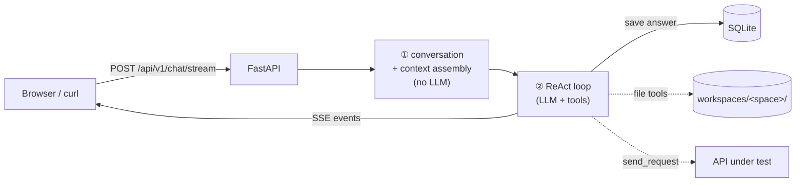

<div align="center">

<p align="center">
  <span style="font-size: 2em; font-weight: bold; vertical-align: middle;">LLMTestAgent</span>
</p>


**LLM-Driven API Automation Testing Agent**

Talk to your APIs in natural language. The agent picks its own tools — under a hard permission boundary.

[Quick Start](#quick-start) · [Configuration](#configuration) · [Agent Runtime](#agent-runtime) · [Memory](#memory-system) · [Development](#development)

[中文](README_zh.md) | English

</div>

---

## Features

- **Space-scoped sandbox** — every test space owns a real directory (`AGENTS.md`, `docs/`, `testcases/`, `artifacts/`); file tools can never escape it
- **Mode = tool whitelist** — `agent` / `ask` / `plan` are enforced on the execution path, not suggested in a prompt. In `ask` mode the model literally has no `write_file` to call
- **Streaming agent runtime** — hand-written ReAct loop with a 6-event SSE protocol (`start` / `text_delta` / `tool_call` / `tool_result` / `final` / `error`); every tool call is visible in the UI
- **Skills** — `SKILL.md` folder convention, builtin + per-space discovery, zip import with zip-slip protection, each skill narrows the tool set further
- **Three-layer memory** — in-request context, cross-session memory per space (DB as source of truth, mirrored to `memory/MEMORY.md`), and a document knowledge base with chunking + optional vector search
- **OpenAPI 3.x parsing** (JSON / YAML) with automatic endpoint extraction and persistence
- **Assertion engine** — JSONPath-based rules (`==`, `contains`, `matches`, `status_code`, `response_time`, …) exposed to the agent as tools
- **Production guard** — environments flagged `is_production` reject write methods and out-of-domain URLs
- **Graceful degradation** — ChromaDB and embeddings are off by default; the knowledge base falls back to lexical search instead of failing
- Full pipeline persistence in SQLite (execution/report generation is currently read-only — see [Test Reports](#test-reports))

---

## Project Structure (Monorepo)

```
LLMTestAgent/
├── backend/          # Python backend (FastAPI + ReAct agent runtime)
│   ├── src/          # Source code
│   ├── skills/       # Builtin SKILL.md folders
│   ├── workspaces/   # Per-space sandbox directories (gitignored)
│   ├── tests/        # Unit / API tests
│   ├── pyproject.toml
│   └── ...
├── frontend/         # React frontend (Vite + Tailwind v4 + shadcn/ui)
│   ├── src/
│   ├── package.json
│   └── ...
├── doc/              # Design documentation
└── .github/          # CI workflows (backend.yml + frontend.yml)
```

---

## Architecture

The runtime is **four stages**, and only the third one touches an LLM:



| Stage | Component | LLM |
|---|---|:--:|
| ① Conversation | `ChatStreamService.ensure_conversation` — reuse or create conversation, persist user message | ❌ |
| ② Context | `prepare()` + `agent/context.py` — snapshots space, history, memories, skills, tool set, `ModePolicy` | ❌ |
| ③ Reasoning | `agent/runner.py` — ReAct loop, stream events | ✅ |
| ④ Persist | `api/v1/chat.py` — render SSE frames, save answer | ❌ |

Because stages ① ② ④ are deterministic, "which tools were available this turn" and "why did this message not reach the model" are answerable offline, without trusting the model's self-report.

See [Architecture.md](doc/design/Architecture.md) and [SystemFlowchart.md](doc/design/SystemFlowchart.md) for the full picture.

---

## Quick Start

### 1. Clone and Install

```bash
git clone https://github.com/cmrhyq/LLMTestAgent.git
cd LLMTestAgent

# Backend
cd backend
uv sync --extra dev
cd ..

# Frontend
cd frontend
npm install
cd ..
```

### 2. Configure the Model

All configuration lives in `backend/config/config.yaml` — there is **no `.env`** and no `${ENV}` interpolation.
Fill in your provider credentials directly in `model_list`:

```yaml
llm:
  default_model: smart-router      # complexity-based auto routing

model_list:
  - model_name: glm-4-flash
    litellm_params:
      model: zai/glm-4-flash
      api_key: your-api-key
  - model_name: deepseek-v4-pro
    litellm_params:
      model: deepseek/deepseek-v4-pro
      api_key: your-api-key
```

> `config.yaml` holds plaintext API keys — make sure it stays out of version control.

### 3. Start Services

```bash
# Backend
cd backend
uv run python app.py
# or
uv run uvicorn app:app --host 0.0.0.0 --port 8000 --reload

# Frontend (another terminal)
cd frontend
npm run dev
```

- API docs: http://localhost:8000/docs
- UI: http://localhost:5173

> On first run the database (`backend/db/TestAgents.db`), all 15 tables, and the migration are created automatically.
> Space directories under `backend/workspaces/` are created the first time you create a space.

---

## Project Structure

```text
LLMTestAgent/
├── backend/
│   ├── app.py                           # FastAPI entry (lifespan: config → db → migration)
│   ├── config/config.yaml               # Application config (only source of config)
│   ├── db/TestAgents.db                 # SQLite database (auto-created)
│   ├── skills/                          # Builtin skills (SKILL.md folders)
│   ├── workspaces/                      # Per-space sandbox dirs (auto-created, gitignored)
│   └── src/
│       ├── agent/                       # Agent runtime
│       │   ├── modes.py                 # Mode → tool whitelist (the permission boundary)
│       │   ├── context.py               # system prompt assembly (≤12k chars)
│       │   ├── events.py                # SSE event protocol
│       │   ├── runner.py                # Hand-written ReAct loop
│       │   └── tools/                   # fs / http / db / memory / knowledge / skill / executor tools
│       ├── workspace/                   # Space directory + path sandbox
│       ├── skill/                       # SKILL.md parsing, discovery, zip import, enable flags
│       ├── memory/                      # Long-term memory + knowledge base
│       ├── api/                         # FastAPI route layer
│       ├── core/                        # config, database, llm gateway, chroma, cache, logging
│       ├── data/                        # models / schemas / repositories / services / migration
│       └── utils/                       # snowflake IDs, HTTP helpers, OpenAPI parser
├── frontend/src/
│   ├── pages/                           # dashboard / spaces(+7 tabs) / chat / skills / run / report
│   ├── components/chat/                 # mode & skill selectors, tool-call cards, bubbles
│   ├── hooks/                           # TanStack Query hooks + use-chat (stream orchestration)
│   └── lib/                             # api client, SSE parser, typed domain models
└── doc/                                 # Design docs
```

---

## Agent Runtime

### Modes

| Mode | Meaning | Tools | Max steps |
|---|---|:--:|:--:|
| `agent` (default) | Pick tools and actually test | 17 | 12 |
| `ask` | Answer questions only | 12 (read-only) | 12 |
| `plan` | Produce a plan, execute nothing | 12 (read-only) | 8 |

`ask` / `plan` never receive `send_request`, `write_file`, `delete_file`, `remember`, or `forget`.
Selecting a skill can only **narrow** this set further, never widen it.

### Tools

| Group | Tools | Guard |
|---|---|---|
| Files | `read_file`, `write_file`, `list_directory`, `delete_file` | Resolved path must stay inside the space root; `AGENTS.md` and `memory/MEMORY.md` are protected |
| HTTP | `list_environments`, `send_request` | Write methods rejected on production environments; URL must belong to that environment |
| Data | `get_space_endpoints`, `get_endpoint_detail_by_id`, `search_space` | Always filtered by `space_id` |
| Memory | `recall`, `remember`, `forget` | Writes are mirrored to `memory/MEMORY.md` |
| Usage | `/api/v1/usage` | `GET /stats` — token and cost aggregated by space / conversation / window |
| Knowledge | `knowledge_search` | Falls back to lexical search when vectors are unavailable |
| Skills | `list_skills`, `read_skill` | Read-only |
| Assertions | `evaluate_assertions`, `extract_jsonpath` | Pure functions |

### SSE events

| Event | Payload |
|---|---|
| `start` | `conversation_id`, `space_id`, `mode`, `tools` |
| `text_delta` | `content` |
| `tool_call` | `id`, `name`, `args` |
| `tool_result` | `id`, `name`, `ok`, `content`, `duration_ms` |
| `final` | `answer`, `usage` |
| `error` | `message` |

Tool failures do not break the stream — they come back as `ok=false` results so the model can correct itself.

---

## Memory System

| Layer | Storage | Editable | Purpose |
|---|---|:--:|---|
| Context | Assembled per request | ❌ | What the model sees this turn |
| Cross-session | `space_memory` table + `memory/MEMORY.md` mirror, isolated per space | ✅ | Conventions, past conclusions, known pitfalls |
| Knowledge base | `knowledge_document` + `knowledge_chunk`, optional vectors | ✅ | Requirement docs, API specs |

Memory recall uses keyword extraction plus SQL `LIKE` rather than vector search: entries are few and precise,
and explainability matters more than recall here. The knowledge base is the layer that benefits from embeddings.

```bash
# Add a memory to a space
curl -X POST http://localhost:8000/api/v1/spaces/<space_id>/memories \
  -H "Content-Type: application/json" \
  -d '{"title": "Auth header", "content": "All endpoints need X-Token", "category": "fact"}'

# Upload a document to the knowledge base
curl -X POST http://localhost:8000/api/v1/spaces/<space_id>/documents \
  -F "file=@requirements.docx"
```

---

## Skills

```
backend/skills/api-test-design/
└── SKILL.md
```

```markdown
---
name: api-test-design
description: Design API test scenario matrices
allowed_tools: [get_space_endpoints, read_file]
---

Methodology injected into the system prompt…
```

Discovery is two-level: `backend/skills/` (builtin) and `<space>/.skills/` (space-scoped, overrides builtin by name).
Import a zip via `POST /api/v1/skills/import` (≤20MB, path escape rejected).

---

## Usage

### API Modules

| Module | Path Prefix | Function |
|---|---|---|
| Spaces | `/api/v1/spaces` | CRUD, workspace tree, `AGENTS.md`, memories, documents |
| Endpoints | `/api/v1/endpoints` | Endpoint definition CRUD |
| Environments | `/api/v1/environments` | Environment CRUD (incl. `is_production`) |
| Test Runs | `/api/v1/test/runs` | Execution history |
| Reports | `/api/v1/reports` | Report list / detail / download |
| Chat | `/api/v1/chat` | `POST /stream` — the single agent entry point (SSE) |
| Conversations | `/api/v1/conversations` | Session list, messages, rename, delete |
| Skills | `/api/v1/skills` | List / detail / zip import / enable |
| Memory | `/api/v1/memories` | Update / delete an entry |
| Knowledge | `/api/v1/documents` | Chunks / reindex / delete |
| OpenAPI | `/api/v1/spaces/parse/openapi/{space_id}` · `/api/v1/workflows/upload/openapi` | Parse and persist a spec |

### Example Requests

```bash
# Parse an OpenAPI document into a space
curl -X POST "http://localhost:8000/api/v1/spaces/<space_id>/parse/openapi" \
  -F "file=@httpbin_service.json"

# Ask the agent to test something (streaming)
curl -N -X POST http://localhost:8000/api/v1/chat/stream \
  -H "Content-Type: application/json" \
  -d '{"instruction": "Test the login endpoint with valid and invalid credentials",
       "space_id": <space_id>,
       "mode": "agent",
       "skill_names": ["api-test-design"]}'
```

The response carries an `X-Conversation-Id` header so clients can continue the same session.

---

## Test Reports

> **Status note**: the report *generation* pipeline (case generation → execution → HTML rendering) was removed
> ahead of the v1.0 refactor. What remains is the read side: `GET /api/v1/reports`, `/{id}`, `/{id}/download`,
> serving records already present in the `report` table. Rebuilding generation on top of the agent runtime is on the roadmap.

---

## Database

SQLite + SQLAlchemy 2.0, snowflake IDs (non-autoincrement), created and migrated on first run.

| Table | Description |
|---|---|
| `space` | Test space (owns a workspace directory) |
| `environment` | Environment config (`is_production` gate) |
| `endpoint` | Parsed API definitions |
| `test_run` / `test_case` / `test_result` / `test_summary` / `report` | Execution and reporting |
| `conversation` / `message` | Sessions (`mode`, `skill_names`, `environment_id`) |
| `space_memory` | Cross-session memory |
| `knowledge_document` / `knowledge_chunk` | Knowledge base |
| `skill` | Skill discovery cache + enable flag |
| `llm_log` | LLM call accounting: real model, tokens, routing tier, cost, attributed to space + conversation |

### Reset Database

```bash
rm backend/db/TestAgents.db     # macOS / Linux
del backend\db\TestAgents.db    # Windows
```

### ER Diagram

See [ER.md](doc/design/ER.md) and [DatabaseDesign.md](doc/design/DatabaseDesign.md).

---

## ChromaDB (Optional)

ChromaDB is **off by default**. With it disabled the knowledge base still works through lexical search.

```yaml
chroma:
  enabled: false                   # set true to use vector search
  host: "your-chromadb-host"
  port: 8000
  auth_credentials: your-token
  tenant: default_tenant
  database: default_database

embedding:
  enabled: false                   # also needs to be true for vectors
  model: zai/embedding-3           # any litellm-compatible embedding model
  api_key: your-api-key
  dimension: 1024
```

When both flags are on, `knowledge_search` uses vectors and automatically degrades to lexical search on failure.
Existing documents can be re-indexed with `POST /api/v1/documents/{id}/reindex`.

---

## Development

```bash
# Backend tests
cd backend
uv run pytest
uv run pytest --cov=src --cov-report=html

# Frontend checks
cd frontend
npm run type-check && npm run lint && npm run build
```

### Add a Tool

1. Write a `make_*_tools(...)` factory in `backend/src/agent/tools/` that returns `@tool` functions
2. Register it in `build_tools()` (`backend/src/agent/tools/registry.py`)
3. Classify it in `src/agent/modes.py` — add it to `SIDE_EFFECT_TOOL_NAMES` unless it is read-only
4. Add a test; `tests/agent/test_skill_tool_contract.py` will fail if a skill declares a tool that does not exist

### Add a Skill

Create `backend/skills/<name>/SKILL.md` with `name`, `description`, and optional `allowed_tools`.
`allowed_tools` must reference **real** tool names — a typo silently removes that tool from the bundle.

### Database Changes

Models live in `backend/src/data/models/`. New tables are picked up by `init_database_from_orm()`;
schema changes to existing tables need a migration module (see `data/migration/v2_agent_migration.py`),
because SQLite cannot alter CHECK constraints in place.

---

## Tech Stack

| Component | Technology |
|---|---|
| Agent orchestration | Hand-written ReAct loop (no LangGraph) |
| LLM framework | LangChain messages + tool binding, LiteLLM Router |
| Vector database | ChromaDB (optional) |
| Observability | LangSmith (optional) |
| Web framework | FastAPI + Uvicorn |
| Database ORM | SQLAlchemy 2.0 |
| Data validation | Pydantic 2 |
| HTTP client | httpx |
| Logging | structlog |
| Configuration | PyYAML |

---

## LangSmith Observability (Optional)

```yaml
langsmith:
  enabled: true
  api_key: your-langsmith-api-key
  space: LLMTestAgent
  endpoint: https://api.smith.langchain.com
```

Set `langsmith.enabled` to `false` (default) to disable — no network calls, no overhead.

---

## FAQ

**Where is the database file?** `backend/db/TestAgents.db`, created on first run. Change `database.url` in `config.yaml`.

**Why can't the agent write files in `ask` mode?** By design — `ask` and `plan` only bind read-only tools.
It is not a prompt instruction the model might ignore; the tool simply is not in the list.

**Why does `knowledge_search` not use vectors?** `chroma.enabled` and `embedding.enabled` both default to `false`.
Enable both, then call `reindex` on existing documents.

**Changing HTTP timeouts in `config.yaml` has no effect.** There is no timeout section in the config schema.
`send_request` takes its timeout as a tool argument (default 30s); the old `execution` block inherited from the
previous engine has been removed from both `config.yaml` and the template. If you need a global default,
wire it into `src/agent/tools/http_tools.py` rather than adding YAML nobody reads.

**No report after running?** Verify the OpenAPI document parses (3.0.x / 3.1.x), the model credentials are valid,
and the space actually contains endpoints.

**Why is `cost_usd` `null` in `/api/v1/usage/stats`?** It means no call in the window could be priced —
**not free**. Usually the model is missing from litellm's price table (`zai/*` is). Add a rate in
`config.yaml` (unit is USD per single token):

```yaml
pricing:
  - model: zai/glm-4-flash
    input_cost_per_token: 0.0000001
    output_cost_per_token: 0.0000002
```

Check `unpriced_calls` alongside it: `cost_usd` only sums the priced calls, so reading it alone
understates the real spend.

---

## License

Licensed under the [Apache License 2.0](LICENSE).
