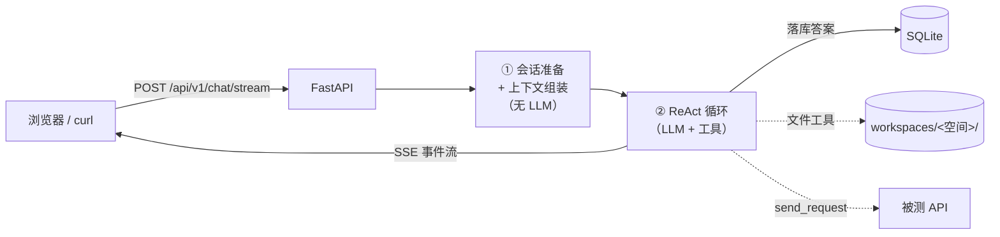

<div align="center">

<p align="center">
  <span style="font-size: 2em; font-weight: bold; vertical-align: middle;">LLMTestAgent</span>
</p>


**基于大模型的 API 自动化测试智能体**

用自然语言指挥测试。Agent 自己挑工具，但工具边界由代码硬性决定。

[快速开始](#快速开始) · [配置说明](#配置说明) · [Agent 运行时](#agent-运行时) · [记忆系统](#记忆系统) · [开发指南](#开发指南)

中文 | [English](README.md)

</div>

---

## 主要功能

- **空间级沙箱** — 每个测试空间对应一个真实目录（`AGENTS.md`、`docs/`、`testcases/`、`artifacts/`），文件工具无法越界
- **模式即工具白名单** — `agent` / `ask` / `plan` 在执行路径上强制生效，不是 prompt 里的一句「请不要」。`ask` 模式下模型手里根本没有 `write_file`
- **流式 Agent 运行时** — 手写 ReAct 循环 + 六事件 SSE 协议（`start` / `text_delta` / `tool_call` / `tool_result` / `final` / `error`），每次工具调用在界面上都看得见
- **Skills** — `SKILL.md` 文件夹规范，内置 + 空间两级发现，zip 导入带 zip-slip 防护，技能只会进一步收窄工具集
- **三层记忆** — 请求内上下文、按空间隔离的跨会话记忆（DB 为真源，镜像到 `memory/MEMORY.md`）、文档知识库（切片 + 可选向量检索）
- **OpenAPI 3.x 解析**（JSON / YAML），自动提取接口并入库
- **断言引擎** — 基于 JSONPath 的规则（`==`、`contains`、`matches`、`status_code`、`response_time` 等），以工具形式暴露给 Agent
- **生产环境闸门** — 标记 `is_production` 的环境拒绝写方法与越界域名
- **优雅降级** — ChromaDB 与 embedding 默认关闭，知识库自动走词法检索而不是直接报错
- SQLite 全链路持久化（报告改为按 run 实时聚合，见 [测试报告](#测试报告)）

---

## 项目结构（Monorepo）

```
LLMTestAgent/
├── backend/          # Python 后端（FastAPI + ReAct Agent 运行时）
│   ├── src/          # 源码
│   ├── skills/       # 内置 SKILL.md 目录
│   ├── workspaces/   # 空间沙箱目录（自动创建，已 gitignore）
│   ├── tests/        # 单元 / 接口测试
│   ├── pyproject.toml
│   └── ...
├── frontend/         # React 前端（Vite + Tailwind v4 + shadcn/ui）
│   ├── src/
│   ├── package.json
│   └── ...
├── doc/              # 设计文档
└── .github/          # CI 工作流（backend.yml + frontend.yml）
```

---

## 架构概览

运行时是**四段式**，只有第三段会调用 LLM：



| 阶段 | 组件 | 是否调 LLM |
|---|---|:--:|
| ① 会话准备 | `ChatStreamService.ensure_conversation` — 复用或新建会话，落库用户消息 | ❌ |
| ② 上下文组装 | `prepare()` + `agent/context.py` — 空间快照、历史、记忆、技能、工具集、`ModePolicy` | ❌ |
| ③ 推理执行 | `agent/runner.py` — ReAct 循环，流式产出事件 | ✅ |
| ④ 渲染落库 | `api/v1/chat.py` — 渲染 SSE 帧，落库答案 | ❌ |

因为 ①②④ 都是确定性代码，「这一轮为什么只有这些工具」「这条消息为什么没进上下文」都可以离线复盘，
不需要相信模型的自述。

完整架构见 [Architecture.md](doc/design/Architecture.md)，流程图见 [SystemFlowchart.md](doc/design/SystemFlowchart.md)。

---

## 快速开始

### 1. 克隆并安装

```bash
git clone https://github.com/cmrhyq/LLMTestAgent.git
cd LLMTestAgent

# 后端
cd backend
uv sync --extra dev
cd ..

# 前端
cd frontend
npm install
cd ..
```

### 2. 配置模型

所有配置集中在 `backend/config/config.yaml`，**没有 `.env`**，也不支持 `${ENV}` 插值。
直接在 `model_list` 里填模型凭证：

```yaml
llm:
  default_model: smart-router      # 按复杂度自动路由

model_list:
  - model_name: glm-4-flash
    litellm_params:
      model: zai/glm-4-flash
      api_key: your-api-key
  - model_name: deepseek-v4-pro
    litellm_params:
      model: deepseek/deepseek-v4-pro
      api_key: your-api-key
```

> `config.yaml` 里是明文 API Key —— 务必确保该文件不入库。

### 3. 启动服务

```bash
# 后端
cd backend
uv run python app.py
# 或
uv run uvicorn app:app --host 0.0.0.0 --port 8000 --reload

# 前端（另开终端）
cd frontend
npm run dev
```

- 接口文档：http://localhost:8000/docs
- 前端界面：http://localhost:5173

> 首次运行会自动创建数据库（`backend/db/TestAgents.db`）、15 张表并执行迁移。
> `backend/workspaces/` 下的空间目录在首次创建空间时生成。

---

## 项目结构

```text
LLMTestAgent/
├── backend/
│   ├── app.py                           # FastAPI 入口（lifespan: 配置 → 数据库 → 迁移）
│   ├── config/config.yaml               # 应用配置（唯一配置源）
│   ├── db/TestAgents.db                 # SQLite 数据库（自动创建）
│   ├── skills/                          # 内置技能（SKILL.md 目录）
│   ├── workspaces/                      # 空间沙箱目录（自动创建，已 gitignore）
│   └── src/
│       ├── agent/                       # Agent 运行时
│       │   ├── modes.py                 # 模式 → 工具白名单（权限边界所在）
│       │   ├── context.py               # system prompt 组装（≤12k 字符）
│       │   ├── events.py                # SSE 事件协议
│       │   ├── runner.py                # 手写 ReAct 循环
│       │   └── tools/                   # fs / http / db / memory / knowledge / skill / executor 工具
│       ├── workspace/                   # 空间目录 + 路径沙箱
│       ├── skill/                       # SKILL.md 解析、发现、zip 导入、启用开关
│       ├── memory/                      # 长期记忆 + 知识库
│       ├── api/                         # FastAPI 路由层
│       ├── core/                        # 配置、数据库、LLM 网关、Chroma、缓存、日志
│       ├── data/                        # models / schemas / repositories / services / migration
│       └── utils/                       # 雪花 ID、HTTP 封装、OpenAPI 解析
├── frontend/src/
│   ├── pages/                           # 仪表盘 / 空间（含 7 个 tab）/ 对话 / 技能 / 运行 / 报告
│   ├── components/chat/                 # 模式与技能选择器、工具调用卡片、消息气泡
│   ├── hooks/                           # TanStack Query hooks + use-chat（流式编排）
│   └── lib/                             # API 客户端、SSE 解析、分域类型定义
└── doc/                                 # 设计文档
```

---

## Agent 运行时

### 模式

| 模式 | 语义 | 工具数 | 最大步数 |
|---|---|:--:|:--:|
| `agent`（默认） | 自动挑工具执行测试 | 17 | 12 |
| `ask` | 只回答问题 | 12（只读） | 12 |
| `plan` | 只出计划，不执行 | 12（只读） | 8 |

`ask` / `plan` 永远拿不到 `send_request`、`write_file`、`delete_file`、`remember`、`forget`。
选择技能只会在该集合上**继续收窄**，绝不放宽。

### 工具

| 分组 | 工具 | 约束 |
|---|---|---|
| 文件 | `read_file`、`write_file`、`list_directory`、`delete_file` | 解析后的路径必须留在空间根内；`AGENTS.md` 与 `memory/MEMORY.md` 受保护 |
| HTTP | `list_environments`、`send_request` | 生产环境拒绝写方法；URL 必须属于该环境 |
| 数据 | `get_space_endpoints`、`get_endpoint_detail_by_id`、`search_space` | 一律按 `space_id` 过滤 |
| 记忆 | `recall`、`remember`、`forget` | 写入同步 `memory/MEMORY.md` 镜像 |
| 知识库 | `knowledge_search` | 向量不可用时降级词法检索 |
| 技能 | `list_skills`、`read_skill` | 只读 |
| 断言 | `evaluate_assertions`、`extract_jsonpath` | 纯函数 |

### SSE 事件

| 事件 | 载荷 |
|---|---|
| `start` | `conversation_id`、`space_id`、`mode`、`tools` |
| `text_delta` | `content` |
| `tool_call` | `id`、`name`、`args` |
| `tool_result` | `id`、`name`、`ok`、`content`、`duration_ms` |
| `final` | `answer`、`usage` |
| `error` | `message` |

工具失败**不会打断流**，而是以 `ok=false` 的结果回灌，让模型自己纠错。

---

## 记忆系统

| 层 | 存储 | 可编辑 | 用途 |
|---|---|:--:|---|
| 上下文 | 每轮请求现拼 | ❌ | 本轮模型能看见什么 |
| 跨会话 | `space_memory` 表 + `memory/MEMORY.md` 镜像，按空间隔离 | ✅ | 空间约定、历史结论、踩过的坑 |
| 知识库 | `knowledge_document` + `knowledge_chunk`，可选向量 | ✅ | 需求文档、接口文档 |

记忆召回用关键词抽取 + SQL `LIKE`，不用向量：记忆条目少而精确，可解释性比召回率更重要。
真正受益于 embedding 的是知识库层。

```bash
# 写入一条空间记忆
curl -X POST http://localhost:8000/api/v1/spaces/<space_id>/memories \
  -H "Content-Type: application/json" \
  -d '{"title": "鉴权头", "content": "所有接口都要带 X-Token", "category": "fact"}'

# 上传文档进知识库
curl -X POST http://localhost:8000/api/v1/spaces/<space_id>/documents \
  -F "file=@requirements.docx"
```

---

## 技能（Skills）

```
backend/skills/api-test-design/
└── SKILL.md
```

```markdown
---
name: api-test-design
description: 设计 API 测试场景矩阵
allowed_tools: [get_space_endpoints, read_file]
---

注入 system prompt 的方法论正文……
```

发现是两级的：`backend/skills/`（内置）与 `<空间>/.skills/`（空间级，同名覆盖内置）。
通过 `POST /api/v1/skills/import` 导入 zip（≤20MB，命中路径逃逸即整包拒绝）。

---

## 使用示例

### API 模块

| 模块 | 前缀 | 功能 |
|---|---|---|
| 空间 | `/api/v1/spaces` | CRUD、目录树、`AGENTS.md`、记忆、文档 |
| 接口 | `/api/v1/endpoints` | 接口定义 CRUD |
| 环境 | `/api/v1/environments` | 环境 CRUD（含 `is_production`） |
| 测试运行 | `/api/v1/agent/runs` | 执行历史、工具调用留痕、清理 |
| 报告 | `/api/v1/reports` | 按 run 聚合 `send_request` 的接口调用报告 |
| 对话 | `/api/v1/chat` | `POST /stream` —— 唯一 Agent 入口（SSE） |
| 会话 | `/api/v1/conversations` | 会话列表、消息、重命名、删除 |
| 技能 | `/api/v1/skills` | 列表 / 详情 / zip 导入 / 启停 |
| 记忆 | `/api/v1/memories` | 修改 / 删除单条 |
| 用量 | `/api/v1/usage` | `GET /stats` —— 按空间/会话/窗口聚合 token 与成本 |
| 知识库 | `/api/v1/documents` | 切片 / 重建索引 / 删除 |
| OpenAPI | `/api/v1/spaces/parse/openapi/{space_id}` · `/api/v1/workflows/upload/openapi` | 解析并入库 |

### 示例请求

```bash
# 把 OpenAPI 文档解析进某个空间
curl -X POST "http://localhost:8000/api/v1/spaces/<space_id>/parse/openapi" \
  -F "file=@httpbin_service.json"

# 让 Agent 测试（流式）
curl -N -X POST http://localhost:8000/api/v1/chat/stream \
  -H "Content-Type: application/json" \
  -d '{"instruction": "测试登录接口，覆盖正确与错误凭证",
       "space_id": <space_id>,
       "mode": "agent",
       "skill_names": ["api-test-design"]}'
```

响应头会带 `X-Conversation-Id`，客户端可据此继续同一会话。

---

## 测试报告

报告不再是一行文件记录，而是**一次执行里的 HTTP 调用**，实时从 `agent_tool_call`
（`tool_name = 'send_request'`）聚合出来：

| 接口 | 返回 |
|---|---|
| `GET /api/v1/reports?space_id=&status=&page=&page_size=` | 一行一个发过 HTTP 请求的 `run_id`，带请求数与成功率 |
| `GET /api/v1/reports/{run_id}` | 执行摘要 + 请求清单（不含正文） |
| `GET /api/v1/reports/{run_id}/requests/{request_id}` | 单条请求的完整请求/响应正文（前端展开时懒加载） |

成功率按 **HTTP 2xx** 计算，不看工具层的 `ok`：`send_request` 对 4xx/5xx 不抛异常，
`ok=1` + 状态码 500 是真实存在的组合。失败拆成两类：`error_count`（拿到响应但非 2xx）
与 `exception_count`（完全没有状态码——网络异常、参数不合法、被生产环境闸门拦截）。

旧的 `report` 表与文件下载接口已删除，迁移 `v4` 会在老库上 DROP 该表。

---

## 数据库

SQLite + SQLAlchemy 2.0，雪花 ID（非自增），首次运行自动建表并迁移。

| 表 | 说明 |
|---|---|
| `space` | 测试空间（持有工作目录） |
| `environment` | 环境配置（`is_production` 闸门） |
| `endpoint` | 解析后的接口定义 |
| `test_run` / `test_case` / `test_result` / `test_summary` / `report` | 执行与报告 |
| `conversation` / `message` | 会话（`mode`、`skill_names`、`environment_id`） |
| `space_memory` | 跨会话记忆 |
| `knowledge_document` / `knowledge_chunk` | 知识库 |
| `skill` | 技能发现缓存 + 启用开关 |
| `llm_log` | LLM 调用账本：真实模型 / tokens / 路由档位 / 成本，按空间与会话归因 |

### 重置数据库

```bash
rm backend/db/TestAgents.db     # macOS / Linux
del backend\db\TestAgents.db    # Windows
```

### ER 图

见 [ER.md](doc/design/ER.md) 与 [DatabaseDesign.md](doc/design/DatabaseDesign.md)。

---

## ChromaDB（可选）

ChromaDB **默认关闭**。关闭时知识库仍可通过词法检索工作。

```yaml
chroma:
  enabled: false                   # 改为 true 才启用向量检索
  host: "your-chromadb-host"
  port: 8000
  auth_credentials: your-token
  tenant: default_tenant
  database: default_database

embedding:
  enabled: false                   # 向量化也需要打开
  model: zai/embedding-3           # 任意 litellm 兼容的 embedding 模型
  api_key: your-api-key
  dimension: 1024
```

两个开关都打开后，`knowledge_search` 走向量检索，失败自动降级词法检索。
已有文档可用 `POST /api/v1/documents/{id}/reindex` 重建索引。

---

## 开发指南

```bash
# 后端测试
cd backend
uv run pytest
uv run pytest --cov=src --cov-report=html

# 前端检查
cd frontend
npm run type-check && npm run lint && npm run build
```

### 新增一个工具

1. 在 `backend/src/agent/tools/` 写一个 `make_*_tools(...)` 工厂，返回 `@tool` 函数
2. 在 `build_tools()`（`backend/src/agent/tools/registry.py`）里注册
3. 在 `src/agent/modes.py` 里分类 —— 除非是只读工具，否则加入 `SIDE_EFFECT_TOOL_NAMES`
4. 补测试；若技能声明了不存在的工具，`tests/agent/test_skill_tool_contract.py` 会失败

### 新增一个技能

创建 `backend/skills/<name>/SKILL.md`，填 `name`、`description` 与可选 `allowed_tools`。
`allowed_tools` 必须引用**真实存在**的工具名 —— 写错不会报错，只会让那个工具被静默裁掉。

### 数据库变更

模型在 `backend/src/data/models/`。新表由 `init_database_from_orm()` 自动创建；
改动已有表的约束需要写迁移模块（参考 `data/migration/v2_agent_migration.py`），
因为 SQLite 无法原地修改 CHECK 约束。

---

## 技术栈

| 组件 | 技术 |
|---|---|
| Agent 编排 | 手写 ReAct 循环（不再使用 LangGraph） |
| LLM 框架 | LangChain 消息与工具绑定 + LiteLLM Router |
| 向量库 | ChromaDB（可选） |
| 可观测性 | LangSmith（可选） |
| Web 框架 | FastAPI + Uvicorn |
| 数据库 ORM | SQLAlchemy 2.0 |
| 数据校验 | Pydantic 2 |
| HTTP 客户端 | httpx |
| 日志 | structlog |
| 配置 | PyYAML |

---

## LangSmith 可观测性（可选）

```yaml
langsmith:
  enabled: true
  api_key: your-langsmith-api-key
  space: LLMTestAgent
  endpoint: https://api.smith.langchain.com
```

`langsmith.enabled` 默认 `false`，关闭时不产生任何网络请求与性能开销。

---

## 常见问题

**数据库文件在哪？** `backend/db/TestAgents.db`，首次运行自动创建。路径由 `config.yaml` 的 `database.url` 决定。

**为什么 `ask` 模式下 Agent 不能写文件？** 设计如此 —— `ask` / `plan` 只绑定只读工具。
这不是 prompt 里的一句建议，而是工具根本不在列表里。

**`knowledge_search` 为什么没走向量？** `chroma.enabled` 和 `embedding.enabled` 默认都是 `false`。
两个都打开，再对已有文档调用 `reindex`。

**改了 `config.yaml` 里 HTTP 超时没生效？** 配置模型里**根本没有超时段**。`send_request` 的超时是工具形参
（默认 30s）。上一代执行引擎留下的 `execution` 段已从 `config.yaml` 与模板中一并删除——留着它只会让人以为能改。
若需要全局默认值，应该接进 `src/agent/tools/http_tools.py`，而不是加一段没人读的 YAML。

**运行后报告里没有内容？** 报告只统计 `send_request` 的调用（见 [测试报告](#测试报告)）。

**`GET /api/v1/usage/stats` 返回的 `cost_usd` 是 `null`？** 表示窗口内没有任何一次调用能定价，
**不是免费**。常见原因是模型不在 litellm 定价表里（`zai/*` 就没有）。在 `config.yaml` 的
`pricing` 段补上费率即可（单位是「美元 / 单个 token」）：

```yaml
pricing:
  - model: zai/glm-4-flash
    input_cost_per_token: 0.0000001
    output_cost_per_token: 0.0000002
```

响应里的 `unpriced_calls` 会告诉你有多少次调用没能计价 —— `cost_usd` 只累加已知部分，
两个字段要一起看，否则会把部分成本当成全部成本。

---

## License

本项目采用 [Apache License 2.0](LICENSE)。
