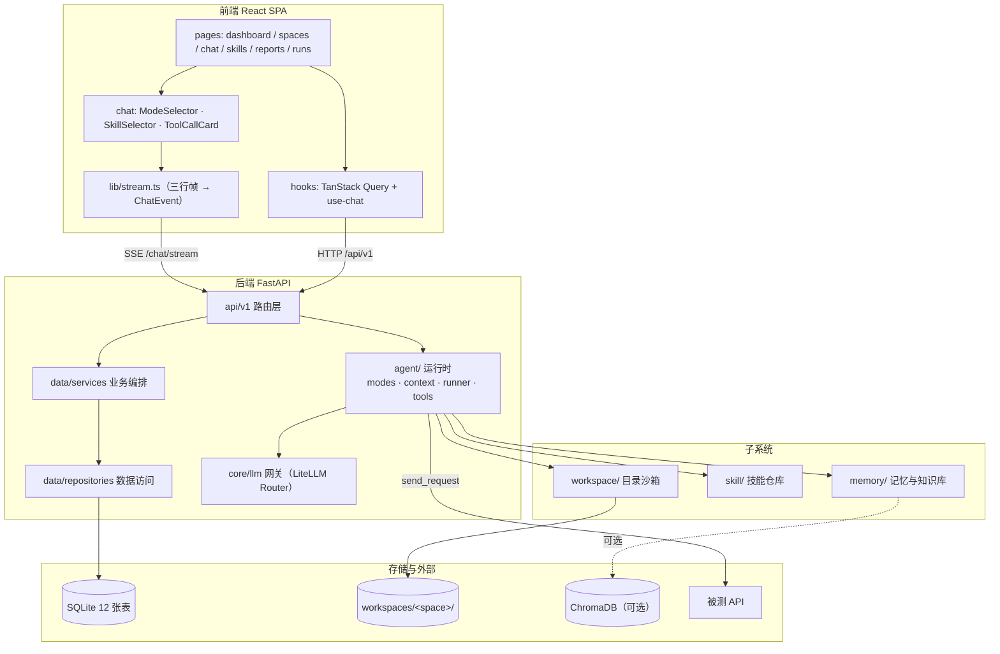
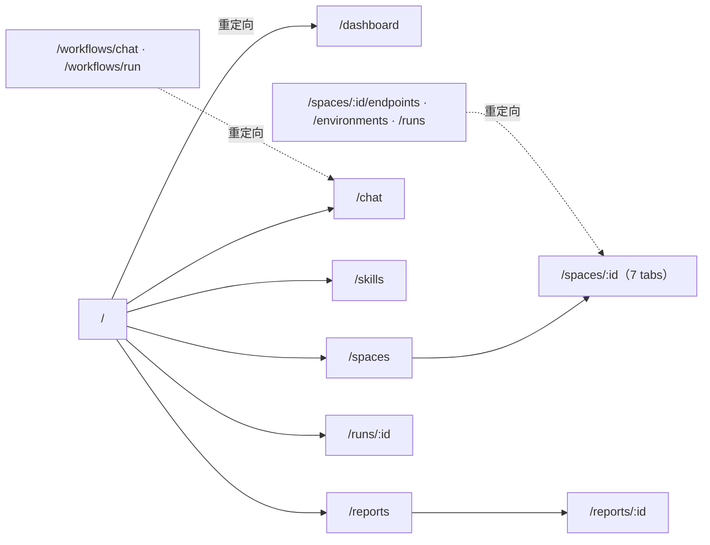

# 架构设计

> 版本：v2.0
> 定位：以当前 `feature/web_ui` 分支的代码实现为准，说明系统由哪些部分组成、边界如何划分、
> 关键机制为什么这样设计。不含未来规划，规划见[测试能力路线](Testing-Agent-Roadmap.md)。
>
> 关联文档：[数据库设计](DatabaseDesign.md) · [ER 图](ER.md) · [系统流程图](SystemFlowchart.md) ·
> [模式设计](Mode-System-Design.md) · [页面设计准则](UI-Design-Guidelines.md) · [变更日志](../CHANGELOG.md)

---

## 一、系统定位

TestAgents 是一个由大模型驱动的 API 自动化测试平台。用户在某个**测试空间**里用自然语言描述测试意图，
Agent 在受限的工具集内自行决定调用什么工具（查接口、发请求、读文档、查记忆、写用例文件），
边推理边执行，过程通过 SSE 实时呈现，结论沉淀为可复用的跨会话记忆与知识库。

设计上有一条贯穿始终的主张：**模型只负责决策「调哪个工具、传什么参数」，
「能用哪些工具、能碰哪些文件、能打哪些地址、最多跑几步」全部由确定性代码决定。**
这一条决定了后文几乎所有的结构选择。

### 1.1 技术栈

| 层 | 技术 |
|---|---|
| 前端 | React 19 · TypeScript · Vite · React Router · TanStack Query · Tailwind CSS v4 · shadcn/ui |
| 后端 | Python ≥ 3.10 · FastAPI · SQLAlchemy 2.0 · Pydantic 2 · structlog |
| LLM 接入 | LiteLLM Router（多模型路由） · langchain-core（消息与工具抽象） · langchain-litellm |
| 数据 | SQLite 3（WAL 模式、雪花 ID 主键） |
| 向量检索 | ChromaDB（可选，默认关闭；关闭时知识库降级为词法检索） |
| Agent 编排 | 手写 ReAct 循环（`src/agent/runner.py`），不使用 LangGraph |

### 1.2 顶层结构



### 1.3 部署形态

- 后端唯一入口 `backend/app.py`，`uvicorn app:app --host 0.0.0.0 --port 8000`，
  业务路由挂在 `/api/v1`，另有 `/health`、`/docs`、`/redoc`。
- 前端 Vite 开发服务器把 `/api` 代理到 `http://localhost:8000`；生产构建为静态资源，由任意静态服务器托管。
- 唯一的长连接端点是 `POST /api/v1/chat/stream`（SSE）。

---

## 二、后端结构

### 2.1 分层

| 层 | 目录 | 职责 |
|---|---|---|
| 路由层 | `api/v1/*` | FastAPI 路由与响应模型；`api/deps.py` 提供请求级 `get_db()` |
| 业务层 | `data/services/*` | 业务编排，如 `ChatStreamService`、`SpaceService`、`ConversationService` |
| 数据访问层 | `data/repositories/*` | 继承泛型 `BaseRepository[T]` 的 CRUD |
| 记录层 | `data/recording/*` | 执行记录落库实现（`AgentRunRecorder`），实现 `agent/recording.py` 的协议 |
| 模型层 | `data/models/*` | SQLAlchemy ORM，共 12 张表 |
| Schema 层 | `data/schemas/*` | Pydantic 请求/响应模型 |
| 迁移层 | `data/migration/*` | `init_database_from_orm()` 与 v2 / v3 / v4 三个幂等迁移 |
| 常量与枚举 | `data/constant/*`、`data/enum/*` | 按主题拆分的常量（`agent` / `memory` / `skills` / `workspace`）与枚举 |
| Agent 运行时 | `agent/*` | `modes`（模式策略）/ `context`（prompt 组装）/ `events`（SSE）/ `runner`（循环）/ `tools`（17 个工具）/ `prompt`（人设与模式指令） |
| 空间子系统 | `workspace/*` | 目录创建、路径沙箱、目录树、归档 |
| 技能子系统 | `skill/*` | `SKILL.md` 解析、两级发现、zip 导入、启用开关 |
| 记忆子系统 | `memory/*` | 长期记忆（DB + Markdown 镜像）、知识库（切片 + 检索） |
| 基础设施 | `core/*` | 配置、数据库连接、LLM 网关、Chroma、缓存、日志 |
| 工具类 | `utils/*` | 雪花 ID、HTTP 封装、OpenAPI 解析 |

> 常量曾被集中放在单个 `constants.py` 里，随子系统增多已按职责拆分。
> 新代码应按归属引入（`from data.constant.agent import ...`），不要继续往单一文件堆。

### 2.2 启动序列（`app.py`）

`lifespan` 中依次执行：

1. `init_config()` —— 读取 `backend/config/config.yaml`，缺文件直接失败（不做静默降级）。
2. `init_database_from_config()` —— 建立 SQLite 连接池，开启 WAL 与外键。
3. `init_database_from_orm()` —— `create_all` → `migrate_v2` → `migrate_v3` → `migrate_v4` → 建分析视图。
4. 关闭时 `db_manager.close()`。

`FastAPI(default_response_class=SafeJSONResponse)`：`SafeIntEncoder` 把超过 JS 安全整数
（`2^53-1`）的整数序列化为字符串。雪花 ID 全部超过这个范围，若不转换，前端会静默丢精度，
表现为「点开 A 空间却请求了 B 空间」。前端类型定义中 ID 统一为 `string | number`，不做 `Number()` 转换。

CORS 来源取环境变量 `CORS_ORIGINS`，默认 `http://localhost:5173`。这是全项目唯一读取环境变量的地方，
其余配置一律来自 YAML。

---

## 三、Agent 运行时

### 3.1 五段式流水线

一轮对话从 `POST /api/v1/chat/stream` 进入，经过五个阶段，只有第三阶段调用大模型：

| 阶段 | 位置 | 调用 LLM | 产出 |
|:--|---|:--:|---|
| ① 会话准备 | `ChatStreamService.ensure_conversation` | 否 | 会话 ID + user 消息落库 |
| ② 上下文组装 | `ChatStreamService.prepare` | 否 | `RunRequest`：system prompt、历史、记忆、技能块、工具集 |
| ③ 记录开启 | `AgentRunRecorder.start` | 否 | `agent_run` 一行（`running`）+ `run_id` |
| ④ 推理执行 | `agent/runner.py::run` | **是** | 事件流（`text_delta` / `tool_call` / `tool_result`） |
| ⑤ 收尾 | `ChatStreamService.stream_answer` 的 `finally` | 否 | `agent_run` 终态、assistant 消息落库、SSE 帧 |

阶段 ①②③⑤ 都是确定性代码。因此「这一轮为什么只有这些工具」「为什么这条消息没进上下文」
「这一步为什么失败」都可以离线复盘，不依赖模型自述。

流程细节见[系统流程图](SystemFlowchart.md)。

### 3.2 ReAct 循环

`runner.run()` 的主体是一层 `for step in range(policy.max_steps)`：

```python
yield StartEvent(conversation_id, space_id, mode, skills, run_id)
for step in range(policy.max_steps):
    accumulated = None
    async for chunk in chat(messages):          # chat 来自 gateway.astream_with_tools
        if text := chunk.text: yield TextDeltaEvent(text)
        accumulated = accumulated + chunk       # 分片合并交给 AIMessageChunk.__add__
    if not accumulated.tool_calls:
        yield FinalEvent(answer=..., usage=...)
        return
    messages.append(AIMessage(...))
    for call in accumulated.tool_calls:
        yield ToolCallEvent(call.id, call.name, call.args)
        outcome = await _execute(tool_map, call.name, call.args)   # 异常转 ok=False
        recorder.tool_call(...)                                   # 落 agent_tool_call
        yield ToolResultEvent(call.id, call.name, outcome.ok, content, duration_ms)
        messages.append(ToolMessage(...))
yield ErrorEvent(f"超过最大工具调用轮次（{policy.max_steps}），已中止本轮")
```

四个刻意的取舍：

1. **工具异常不打断流**。异常一律转成 `ok=False` 的工具结果回灌模型，让模型自己纠错
   （换参数、换工具、或直接说明做不到）。把堆栈抛给用户，等于把内部错误当成产品缺陷暴露。
2. **执行前二次校验工具名**。模型编造出不存在的工具时，`_execute` 查 `tool_map` 不命中即返回
   `工具 X 不存在，当前可用工具：…`。模式限制不是「模型看不见所以不会调」，而是「调了也执行不了」。
3. **落库与截断分离**。工具结果全量写 `agent_tool_call`（上限 2 MB），给模型看的截到 8000 字符，
   走 SSE 的截到 4000 字符。三个上限服务三个不同的约束，不能合并。
4. **流式分片可降级**。`_merge` 优先用 `AIMessageChunk.__add__`；个别 provider 的私有 chunk 不可相加时，
   退化成只拼接文本，宁可丢结构化字段也不中断整轮。

### 3.3 模式 = 工具白名单

| 模式 | 语义 | 工具数 | 最大步数 |
|---|---|:--:|:--:|
| `agent`（默认） | 自行选择工具完成测试 | 17 | 100 |
| `ask` | 只回答与分析 | 12（只读） | 100 |
| `plan` | 只输出计划 | 12（只读） | 80 |

实现在 `src/agent/modes.py`：`Mode` 枚举、`SIDE_EFFECT_TOOL_NAMES`、`READ_ONLY_TOOL_NAMES`、
`ModePolicy`、`normalize_mode()`、`policy_for()`、`filter_tools()`。

- `ask` / `plan` 拿不到 `send_request`、`write_file`、`delete_file`、`remember`、`forget`。
- 选中技能只能在当前模式基础上**收窄**（`Skill.allowed_tools` 与模式白名单取交集）。
- 旧值 `Run` / `Ask` / `Plan` 由 `normalize_mode()` 映射为小写；数据库层只接受小写。
- `runner` 在装配后又调用了一次 `filter_tools`：`ToolBundle` 可能由调用方手工构造，
  模式保证必须在执行路径上闭环，不能只依赖装配处。

> 步数上限从早期的 12/8 调整为 100/80。原来的数字在真实回归场景里经常不够——
> 「读 20 个接口定义 → 逐个发请求 → 逐条断言」必然超过 12 步，触发中止后用户只能重来。
> 上限的作用是兜住死循环，不是节省成本；成本控制靠 token 统计与技能收窄。

### 3.4 工具清单

| 模块 | 工具 | 关键约束 |
|---|---|---|
| `fs_tools.py` | `read_file` · `write_file` · `list_directory` · `delete_file` | 路径 `resolve()` 后必须 `is_relative_to(space_root)`；`AGENTS.md` 与 `memory/MEMORY.md` 禁止删除；读 200 KB / 写 1 MB 上限 |
| `http_tools.py` | `list_environments` · `send_request` | 环境 `is_production=1` 时拒绝写方法；URL 必须属于该环境域名；超时是工具形参（默认 30 s） |
| `db_tools.py` | `get_space_endpoints` · `get_endpoint_detail_by_id` | 一律带 `space_id` 过滤，跨空间不可见 |
| `memory_tools.py` | `recall` · `remember` · `forget` | 写入后同步 `memory/MEMORY.md` 镜像 |
| `knowledge_tools.py` | `knowledge_search` | 向量不可用时自动降级词法检索 |
| `skill_tools.py` | `list_skills` · `read_skill` | 只读 |
| `executor_tools.py` | `evaluate_assertions` · `extract_jsonpath` | 纯函数，无副作用 |

`search_space` 单独注册（`db_tools.py` 导出，在 `build_tools` 里先入列）。

装配入口 `registry.py::build_tools(space_id, mode, skill_names, conversation_id, environment_id)`
返回 `ToolBundle`（工具列表 + policy + 技能声明工具集 + 被裁掉的名字）。

> `agent/tools/` 下的 `report_tools.py` 与 `openapi_tools.py` 当前**未被装配**，
> 也没有任何调用方。保留它们是历史遗留，新增工具时不要以它们为模板。

### 3.5 SSE 事件协议

`src/agent/events.py` 定义六种事件。`render(event, seq)` 输出 `id:` / `event:` / `data:` 三行加空行，
`data` 为 JSON，含 `seq`、`type`、`ts` 与事件自身载荷。

| 事件 | 载荷 | 前端处理 |
|---|---|---|
| `start` | `conversation_id`、`space_id`、`mode`、`skills`、`run_id` | 初始化本轮骨架，记录 `run_id` 供跳转执行详情 |
| `text_delta` | `content` | 追加到气泡，触发流式 Markdown |
| `tool_call` | `id`、`name`、`args` | 插入折叠的工具卡片 |
| `tool_result` | `id`、`name`、`ok`、`content`、`duration_ms` | 按 `id` 回填卡片，`ok=false` 着错误色 |
| `final` | `answer`、`usage` | 收尾，显示 token 用量 |
| `error` | `message` | 告警条，保留已收到的部分输出 |

事件名是前后端契约，改名即破坏兼容。新增字段属于向后兼容的增量（`run_id` 就是这样加进去的）。

响应头固定设置 `Cache-Control: no-cache`、`Connection: keep-alive`、`X-Accel-Buffering: no`。
最后一条不可省：缺了它，nginx 会把整条流攒完再一次性吐出，流式失去意义。
会话 ID 通过 `X-Conversation-Id` 回传。

### 3.6 system prompt 组装

`src/agent/context.py::build_system_prompt` 按固定顺序拼接：

```
人设 + 当前模式指令（永不裁剪）
  → 空间上下文（名称 / ID / 接口数 / 环境清单 / AGENTS.md）
  → 相关记忆（≤3000 字符）
  → 技能正文
  → 工具与目录约定（永不裁剪）
```

总长上限 12000 字符。超限时的裁剪顺序是**先技能、后记忆**：空间上下文与模式指令决定「能不能做对」，
技能决定「做得多规范」，记忆决定「记不记得上次」。预算不足 200 字符时直接不给技能块——
塞进去只会变成噪音。

### 3.7 执行记录

`agent/recording.py` 只定义契约（`RunRecorder` 协议、`ToolOutcome`、`NullRecorder`），
落库实现在 `data/recording/agent_run_recorder.py`。三个方法都是**同步**的：
流结束时生成器处于 `GeneratorExit` 状态，此时 `await` 会抛 `CancelledError`，写库根本来不及完成。

`AgentRunRecorder` 的职责：

- `start()` 写 `agent_run`（`running`），返回 `run_id`；失败返回 `None`，整轮降级为不记录。
- `tool_call()` 写 `agent_tool_call`，并从 `send_request` 的参数与结果里抽出 HTTP 明细
  （方法、URL、状态码、请求/响应头与体），敏感头（`authorization`、`cookie`、`x-token` 等）脱敏后落库。
- `finish()` 从 `llm_log` 按 `run_id` 聚合 token 与成本，算出成功率与平均耗时，写入终态。

`NullRecorder` 用于单元测试与数据库不可用的场景，保证 runner 在没有 DB 时也能跑通。

---

## 四、空间沙箱

一个 `space` 行对应磁盘上一个目录。目录既是 Agent 的读写沙箱，也是人类可读的工作区。

```
backend/workspaces/<space_id>/
├── AGENTS.md          # 空间约定，用户可编辑，注入 system prompt
├── memory/MEMORY.md   # 跨会话记忆的 Markdown 镜像（DB 为真源，此文件只读）
├── docs/              # 需求与接口文档，知识库落盘位置
├── testcases/         # Agent 生成的用例
└── artifacts/         # 执行产物（响应体、导出文件）
```

| 能力 | 接口 | 说明 |
|---|---|---|
| 创建 | `WorkspaceManager.create(space_id)` | 空间创建时建目录与模板文件；已存在则跳过 |
| 路径解析 | `resolve(space_id, rel)` | 越界抛 `PathEscapeError`，含 `..`、绝对路径、Windows 盘符 |
| 目录树 | `GET /spaces/{id}/tree` | 受 `tree_max_depth`、`tree_max_entries` 限制 |
| 约定文件 | `GET` / `PUT /spaces/{id}/agents-md` | 用户可直接编辑 |
| 归档 | `WorkspaceManager.archive(space_id)` | 删除空间时重命名为 `workspaces/.deleted-{id}-{时间戳}`，不物理删除 |

遍历目录时跳过 `__pycache__`、`.git`、`.idea`、`.mypy_cache`、`.pytest_cache`、`.ruff_cache`、`node_modules`。

---

## 五、技能子系统

沿用 `SKILL.md` 文件夹规范：一个技能 = 一个目录 + 一个带 YAML frontmatter 的 `SKILL.md`。

```markdown
---
name: api-test-design
description: 为一组接口设计可执行的测试场景矩阵
when_to_use: 当用户要求设计测试用例或测试计划时
version: 1.0.0
allowed_tools: [get_space_endpoints, read_file]
---

正文（注入 system prompt 的方法论）
```

| 组件 | 职责 |
|---|---|
| `manifest.py` | 解析 frontmatter、校验名称格式、渲染 prompt 块 |
| `repository.py` | 两级发现：`backend/skills/`（内置）与 `<space>/.skills/`（空间级），同名时空间优先 |
| `service.py` | zip 导入（防 zip-slip）、渲染技能块、解析 `allowed_tools` 并集 |
| `registry.py` | DB 侧启用开关缓存，启动时从磁盘同步 |

- 内置技能两个：`api-test-design`（场景矩阵方法论）、`api-regression-run`（回归执行流程）。
- 导入限制：zip ≤ 20 MB，逐条校验 `..`、绝对路径、盘符，命中即整包拒绝。
- 技能声明的 `allowed_tools` 必须引用真实存在的工具名。`tests/agent/test_skill_tool_contract.py`
  会检查这一点——写错名字不会报错，只会静默地把该工具从本轮工具集中移除。

---

## 六、记忆系统

三层，按「生命周期」与「可编辑性」划分：

| 层 | 实现 | 生命周期 | 可编辑 | 用途 |
|---|---|---|---|---|
| 上下文 | `build_system_prompt` 的拼装结果 | 单轮请求 | 否 | 本轮模型能看到什么 |
| 跨会话记忆 | `LongTermMemory`（DB + `MEMORY.md` 镜像） | 跨会话 | 是 | 空间约定、历史结论、已知问题 |
| 领域知识库 | `KnowledgeBase`（切片 + 检索） | 长期 | 是 | 需求文档、接口文档 |

### 6.1 跨会话记忆

- 表 `space_memory`，按 `space_id` 隔离，`category` 取值 `fact` / `decision` / `preference` / `issue` / `glossary`。
- **DB 为真源，Markdown 为镜像**：任何写操作后 `sync_markdown()` 全量重渲染 `memory/MEMORY.md`。
  全量而非增量，是为了让文件永远等于数据库，不需要处理「增量合并」这种容易长期漂移的逻辑。
- 召回用「关键词抽取 + `LIKE`」而非整句匹配。整句 `LIKE` 永远命中不了
  「帮我看看登录接口的鉴权方式」这类自然语言——没有任何一条记忆会包含整句话。

### 6.2 知识库

- 表 `knowledge_document`（`status`：`pending` / `indexed` / `failed`；`index_mode`：`vector` / `lexical`）
  与 `knowledge_chunk`（800 字符一片，重叠 100）。
- 检索双路径：`_vector_search`（Chroma + embedding）失败时降级 `_lexical_search`
  （SQLite `LIKE` + 词频加权）。
- 向量生效需要 `chroma.enabled`、`embedding.enabled`、`embedding.model` 三者同时成立。
  缺任何一个都不实例化向量检索，也不报错——离线环境应当能完整跑词法检索。
- `POST /documents/{id}/reindex` 可在补齐 embedding 配置后重建索引。

---

## 七、LLM 层与成本账本

### 7.1 模型层

`config.yaml` 顶层 `model_list` 定义模型池（`model_name` + `litellm_params`），由 `litellm.Router` 统一路由。
`llm.default_model` 填具体模型名则固定使用，填 `smart-router` 则按提示词复杂度分流到
`SIMPLE` / `MEDIUM` / `COMPLEX` / `REASONING` 四档。

> `smart-router` 只在**异步**路径生效。`Router.acompletion` 会走 `async_pre_routing_hook`，
> 同步 `Router.completion` 不走，会把 `auto_router/complexity_router` 当作普通 provider
> 并报 `Unmapped LLM provider`。本项目的对话与工具调用均为异步，因此默认值安全。

接入路径有两个类：

| 类 | 输入 | 输出 | 适用场景 |
|---|---|---|---|
| `LLMGateway` | `list[dict]` 或 `BaseMessage` | `str` / `AIMessage` / `AIMessageChunk` | 简单问答、工具调用、Agent 运行时 |
| `LLMService` | `list[BaseMessage]` | 原始 `AIMessage` / `AIMessageChunk` | 需要 `usage_metadata` 的底层场景 |

`runner` 每轮调用 `gateway.astream_with_tools(messages, tools, space_id=…, conversation_id=…, run_id=…)`。
该方法把 `bind_tools` + `astream` + 埋点收敛在同一处，全程使用原生消息对象。

`gateway.get_model()` 是「直接取底层 `BaseChatModel`」的旧快路径，**不经过埋点**，
已加 `DeprecationWarning` 并抛出。业务代码不得使用——绕过它一次，那一轮的 token 与成本就是空白。

### 7.2 成本统计

- 埋点在 `LLMService._record_usage`，由所有带埋点的方法统一调用。
- 一轮 ReAct 对话产生 1~N 条 `llm_log`：每个工具轮、每个总结轮都是独立计费调用。
- token 采集策略是「**保留最后一次非空**」而非「只看最后一块」。部分 provider 把 usage
  放在中间 chunk，末块判定会静默记成 0。
- 成本用定价表计算：优先 `config.pricing`，其次 `litellm.model_cost`。定价表查不到的模型记 NULL。
- 进程启动时设置 `LITELLM_LOCAL_MODEL_COST_MAP=True`，关闭远端定价表拉取——否则离线环境会阻塞，
  且同一模型的计算结果会随成本表来源漂移。

> **成本未知不等于免费**。`cost_usd` 为 NULL 表示「定价表查不到」，为 0 表示「确实免费」。
> `GET /api/v1/usage/stats` 同时返回金额与 `unpriced_calls`，两者要一起看。

> **真实模型名不能取 `response_metadata["model"]`**。该键为空，兜底会把所有调用记成
> Router 的逻辑组名（`smart-router`），而组名没有定价，成本将永远是 NULL。
> 取值优先级：`deployment` → `routing_decision.routed_model` → `deployment_model_name` → `model_name` / `model`。

### 7.3 Prompt 体系

没有模板文件。system prompt 由 `agent/context.py` 按 §3.6 的顺序拼装，
空间约定来自用户可编辑的 `AGENTS.md`，方法论来自技能正文。
这样「用户能改的东西」和「模型看到的东西」是同一个文件，不需要理解模板语法。

---

## 八、数据层

- 12 张表，分四个域：配置（`space` / `environment` / `endpoint`）、对话（`conversation` / `message`）、
  执行（`agent_run` / `agent_tool_call` / `llm_log`）、知识与技能（`knowledge_document` /
  `knowledge_chunk` / `space_memory` / `skill`）。
- 主键：全局雪花 ID（`utils/id` 的 `next_id`，`autoincrement=False`）。
- 时间：`Text` 存本地时间字符串（`local_now`）。
- 迁移：`create_all` 只建不存在的表；**给已有表加列或加索引必须写迁移脚本**，
  因为 `create_all` 不会 ALTER 已存在的表。

字段与约束见[数据库设计](DatabaseDesign.md)，关系见 [ER 图](ER.md)。

### 8.1 执行记录与成本的关系

`agent_run` 是一轮的总账，`agent_tool_call` 是工具明细，`llm_log` 是计费流水。
三者通过 `run_id` 串起来，但 `llm_log.run_id` 只是普通列（无外键）：
删除执行记录不会删账单。`agent_run` 收尾时按 `run_id` 从 `llm_log` 聚合出
`llm_call_count` / `total_tokens` / `cost_usd` 冗余落库，列表页因此不必聚合明细。

---

## 九、API 路由清单

| 路由文件 | 前缀 | 端点 |
|---|---|---|
| `space.py` | `/spaces` | `POST /` · `GET /` · `GET /{id}` · `PUT /{id}` · `DELETE /{id}` · `POST /parse/openapi/{id}` · `GET /{id}/tree` · `GET` / `PUT /{id}/agents-md` |
| `endpoint.py` | `/endpoints` | `POST /` · `POST /batch` · `GET /` · `GET /{id}` · `PUT /{id}` · `DELETE /{id}` |
| `environment.py` | `/environments` | `POST /` · `GET /` · `GET /{id}` · `PUT /{id}` · `DELETE /{id}` |
| `agent_run.py` | `/agent/runs` | `GET /` · `GET /{run_id}` · `GET /{run_id}/tool-calls`（`include_body` 控制是否带正文） · `DELETE /cleanup` |
| `report.py` | `/reports` | `GET /`（按 `run_id` 聚合 `send_request`） · `GET /{run_id}` · `GET /{run_id}/requests/{request_id}` |
| `workflow.py` | `/workflows` | `POST /upload/openapi`（仅解析入库，执行统一走 `/chat/stream`） |
| `chat.py` | `/chat` | `POST /stream`（SSE） |
| `conversation.py` | `/conversations` | `POST /` · `GET /` · `GET /{id}` · `GET /{id}/messages` · `PUT /{id}` · `DELETE /{id}` |
| `skill.py` | `/skills` | `GET` · `GET /{name}` · `POST /import` · `PATCH /{name}` |
| `memory.py` | （无统一前缀） | `GET` / `POST /spaces/{id}/memories` · `POST /spaces/{id}/memories/sync` · `PUT` / `DELETE /memories/{id}` |
| `knowledge.py` | （无统一前缀） | `GET` / `POST /spaces/{id}/documents` · `POST /spaces/{id}/documents/search` · `GET /documents/{id}/chunks` · `POST /documents/{id}/reindex` · `DELETE /documents/{id}` |
| `usage.py` | （无统一前缀） | `GET /usage/stats`（按空间 / 会话 / 时间窗口聚合 token 与成本） |

> `memory.py` 与 `knowledge.py` 的路径同时以 `/spaces/{id}/...` 与 `/memories/{id}`、`/documents/{id}`
> 两种形态出现，因此这两个路由不设统一前缀。它们与空间绑定，但资源 ID 本身就是全局唯一的。

---

## 十、前端架构

### 10.1 目录

| 目录 | 职责 |
|---|---|
| `components/layout/` | 应用骨架：`app-layout`、`top-bar`、`sidebar`、`spaces-section`、`page-header` |
| `components/chat/` | `chat-input`、`message-bubbles`、`conversation-list`、`mode-selector`、`skill-selector`、`tool-call-card` |
| `components/space/`、`components/endpoint/`、`components/environment/`、`components/report/` | 按域拆分的业务组件 |
| `components/shared/` | `data-table`、`status-badge`、`http-method-badge`、`pass-rate-bar`、`confirm-delete-dialog`、`empty-state`、`error-boundary`、`query-error-state`、`detail-page-skeleton`、`theme-toggle` |
| `components/markdown/` | Markdown 渲染（remark / rehype / Shiki / Mermaid / 流式光标） |
| `components/ui/` | shadcn/ui 基元 |
| `pages/` | `dashboard`、`space`（列表与详情，详情含 7 个 tab）、`chat`、`skills`、`run`（执行详情）、`report`（列表与单份报告）、`error` |
| `hooks/` | 按域拆分的 TanStack Query hooks + `use-chat`（流式编排）+ 主题、防抖、节流 |
| `lib/` | `api.ts`（axios）、`stream.ts`（SSE 解析）、`types/`（按域拆分）、`query-keys.ts`、`create-crud-hooks.ts` |

### 10.2 路由



空间详情 7 个 tab：概览（AGENTS.md + 目录树）／会话／接口／环境／记忆／知识库／执行记录。

### 10.3 数据获取与流式

- 统一用 TanStack Query，`queryKey` 集中在 `lib/query-keys.ts`，变更后 `invalidateQueries`。
- 普通请求走 `lib/api.ts`（axios，`baseURL: /api/v1`）；流式对话走 `lib/stream.ts`
  的 `fetch + ReadableStream`，把三行帧解析成 `ChatEvent` 判别联合。
  不用 `EventSource`：它不支持 `POST`，也无法自定义请求头。
- `hooks/use-chat.ts` 负责组装请求、消费事件、维护「已落库消息 + 本轮 overlay」两份状态。
  overlay 保留到下一次提问前，避免回答在流结束后闪一下消失。
- 执行轨迹有两处入口：对话页的工具卡片（实时）、执行详情页 `/runs/:id`（事后回放，
  数据来自 `agent_tool_call`）。

---

## 十一、配置体系

配置文件 `backend/config/config.yaml`，模板为同目录 `config.yaml.example`。
配置**只从 YAML 读取**，没有 `.env`，也没有 `${ENV}` 插值。

| 段 | 内容 |
|---|---|
| `llm` | `default_model`（默认 `smart-router`） |
| `model_list` | LiteLLM Router 模型池 |
| `database` | SQLite URL、连接池参数 |
| `chroma` | `enabled`（默认 false）、host / port / 认证 / tenant / database |
| `embedding` | `enabled`（默认 false）、`model`、`api_key`、`base_url`、`dimension` |
| `workspace` | `root`、`max_file_size_kb`、`tree_max_depth`、`tree_max_entries` |
| `skill` | `builtin_root`、`max_skill_chars` |
| `pricing` | 自定义模型费率（美分/单个 token），补齐 litellm 未收录的厂商 |
| `logging` | `level`、`format`（console / json） |

> **Pydantic 会静默丢弃未知键**。`AppConfig` 未设 `extra="forbid"`，字段名拼错**不会报错**，
> 只是安静地走默认值。改完配置建议执行
> `python -c "from src.core.config import init_config; print(init_config())"` 核对实际取值。

> **超时没有配置入口**。`send_request` 的超时是工具形参（默认 30 s），配置模型里没有对应字段。
> 早期遗留的 `execution` 段（超时 / 重试 / 并发）从未被任何代码读取，已从配置文件中删除。
> 若要支持全局默认值，应新增 `http` 段并接进 `http_tools`，而不是复活旧段。

> **`config.yaml` 含明文 API Key**，已被 `.gitignore` 忽略；只有 `config.yaml.example` 入库。

---

## 十二、跨切面设计

| 主题 | 做法 |
|---|---|
| 大整数精度 | 后端 `SafeJSONResponse` 把雪花 ID 序列化为字符串；前端 ID 类型为 `string | number`，禁止 `Number()` |
| 模式即权限 | 工具白名单在装配处与执行处各裁一次，不是 prompt 提示 |
| 文件沙箱 | `resolve()` 后强制 `is_relative_to(space_root)`，拦 `..` 与绝对路径 |
| 生产环境闸门 | `is_production=1` 时 `send_request` 拒绝写方法，URL 必须属于该环境 |
| 降级优先 | Chroma / embedding 默认关闭；记忆召回无命中、知识库无向量、技能读取失败都不阻断对话 |
| 上下文兜底 | 空间查不到给占位名、历史读失败当单轮、`AGENTS.md` 缺失跳过。单块缺失不影响整轮 |
| 数据一致性 | SQLite 为权威源；Chroma 只是可重建的索引层；`MEMORY.md` 只是可重建的镜像 |
| 流式契约 | 三行帧 + 单调 `seq`，事件名稳定；断点续传未实现 |

---

## 十三、已知限制

这些是当前实现的边界，不是缺陷清单。全部为「已明确不做」，不是「忘了做」。

1. **事件不可重放**。SSE 帧只在流里存在，落库的只有 user / assistant 消息与工具调用明细。
   断线后无法续传，只能重新提问。补齐需要 `conversation_event` 表。
2. **无人工审批流**。生产环境闸门是硬拒绝，不是「挂起等确认」。`plan` 模式的计划是文字，
   没有结构化的计划卡与批准动作。
3. **`mode` 不做服务端授权校验**。服务端只做归一化，不校验调用者是否有权使用某模式。
   多租户场景下这是必须补的一环。
4. **测试资产层缺失**。没有 `test_case` / `test_result` 表，用例以 `testcases/` 下的文件形式存在，
   不可版本化、不可 diff、不可批量重跑。报告是按 `run_id` 实时聚合 HTTP 调用，不是持久化的用例结果。
5. **成本额度未接入前端**。`GET /api/v1/usage/stats` 已可用，仪表盘暂未展示。
6. **`cost_usd` 依赖定价表覆盖度**。`zai/*` 等厂商不在 litellm 定价表内，需要在 `config.pricing` 手工补费率，
   否则金额恒为 NULL。

---

## 十四、文档索引

| 文档 | 内容 |
|---|---|
| [DatabaseDesign.md](DatabaseDesign.md) | 12 张表的字段、约束、索引与设计取舍 |
| [ER.md](ER.md) | 实体关系、逻辑引用、删除传播 |
| [SystemFlowchart.md](SystemFlowchart.md) | 一轮对话的完整时序与阶段详解 |
| [Mode-System-Design.md](Mode-System-Design.md) | 模式分层的设计理由与实现对照 |
| [UI-Design-Guidelines.md](UI-Design-Guidelines.md) | 前端视觉令牌、组件准则、页面骨架 |
| [Testing-Agent-Roadmap.md](Testing-Agent-Roadmap.md) | 能力分层、当前缺口与后续阶段 |
| [../../CHANGELOG.md](../../CHANGELOG.md) | 代码与依赖变更 |
| [../CHANGELOG.md](../CHANGELOG.md) | 架构与产品设计变更 |

关键源码入口：`backend/app.py`、`backend/src/agent/runner.py`、`backend/src/agent/modes.py`、
`backend/src/agent/tools/registry.py`、`backend/src/data/recording/agent_run_recorder.py`、
`backend/src/data/services/chat_stream_service.py`、`frontend/src/hooks/use-chat.ts`。

---

## 十五、修订记录

| 版本 | 日期 | 说明 |
|---|---|---|
| 2.0 | 2026-11-04 | 按当前代码重写：五段式流水线（新增执行记录阶段）；模式步数上限 12/8 → 100/80；工具与路由清单对齐代码；删除已不存在的 `test_run` / `report` 相关描述；新增执行记录、成本账本、截断三档、已知限制六条；表数量 15 → 12；PlantUML 副本移除 |
| 1.0 | 2026-10-20 | 运行时替换：LangGraph 与旧 Prompt 体系删除，改为手写 ReAct + 模式白名单 + SSE 六事件；新增 workspace / skill / memory 三个子系统 |
| 0.5 | 2026-08-28 | LLM 层改为 LiteLLM Router + 原生消息对象 |
| 0.4 | 2026-08-27 | `project` → `space` 术语同步 |
| 0.3 | 2026-08-13 | 初稿 |
