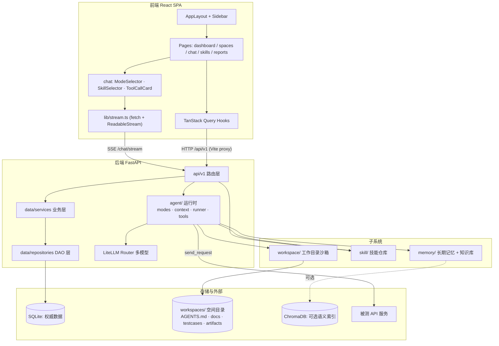
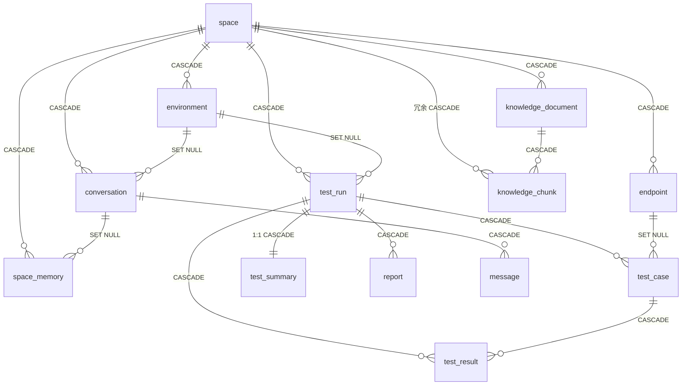
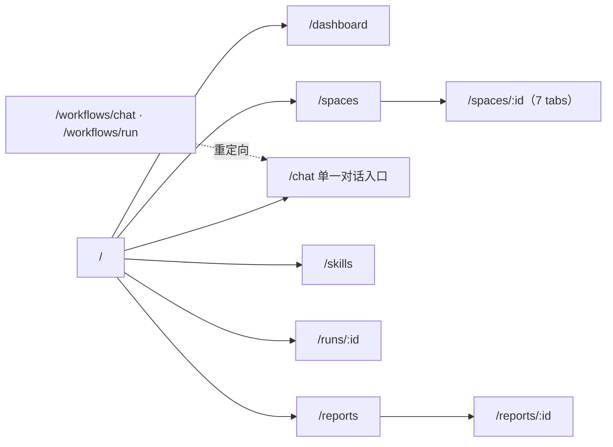

# TestAgents 架构设计文档

> 版本：v1.0（对应当前代码实现，2026-10-20）
> 定位：本文是对 **当前真实实现** 的整体架构说明，跨越前端、后端、数据层、Agent 运行时与外部依赖。
>
> 与其他文档关系：本文为总览；[数据库设计](DatabaseDesign.md)、[ER 图](ER.md)、[系统流程图](SystemFlowchart.md)、
> [页面设计准则](UI-Design-Guidelines.md)、[重构设计](Refactor-Design.md)、[变更日志](../CHANGELOG.md)。

> [!NOTE]
> v1.0 是一次**运行时替换**级别的重构：LangGraph 工作流（`src/workflow.py`、`src/graph/**`）与旧 Prompt 体系
> （`src/prompts/`）已整体删除，换成手写 ReAct 运行时 + 模式工具白名单 + 空间工作目录沙箱 + Skills / 记忆 / 知识库三个子系统。
> 历史设计不再保留在本文正文，需要时查 `git log` 与 [Mode-System-Gap-Analysis.md](Mode-System-Gap-Analysis.md)。

---

## 一、系统总览

**TestAgents** 是一个由大模型驱动的 API 自动化测试平台。用户选定测试空间后，用自然语言描述测试意图，
Agent 按所选**工作模式**在受限的工具集内自主调用工具（查接口、发请求、读文档、查记忆、写用例文件），
边推理边执行，全过程以 SSE 事件流实时呈现，并将结论沉淀为可复用的跨会话记忆与知识库。

### 1.1 技术栈

| 层   | 技术                                                                                                 |
|-----|----------------------------------------------------------------------------------------------------|
| 前端  | React 19 + TypeScript + Vite + React Router + TanStack Query + Tailwind CSS v4 + shadcn/ui + Radix |
| 后端  | Python 3.12 + FastAPI + SQLAlchemy 2.0 + LangChain（仅用消息类型与工具绑定）+ structlog                    |
| 数据  | SQLite 3（WAL 模式，雪花 ID 主键）                                                                          |
| 向量库 | ChromaDB（可选，`chroma.enabled` / `embedding.enabled` 默认 false，关闭时知识库降级词法检索）                         |
| LLM | LiteLLM Router 多模型路由（glm / deepseek 等）+ langchain-litellm（ChatLiteLLMRouter）                              |
| 编排  | **手写 ReAct 循环**（`src/agent/runner.py`），不使用 LangGraph                                                          |

### 1.2 顶层架构图



### 1.3 请求入口与部署形态

- 前端开发服务器（Vite）通过 `proxy` 把 `/api` 转发到后端 `http://localhost:8000`。
- 后端 `backend/app.py` 是唯一入口，`uvicorn app:app --host 0.0.0.0 --port 8000`，业务路由挂在 `/api/v1` 前缀下，
  另有 `GET /health`、`/docs`、`/redoc`。
- 唯一会长时间保持连接的端点是 `POST /api/v1/chat/stream`（SSE）。

---

## 二、后端架构

### 2.1 分层结构（`backend/src/`）

| 层        | 目录                    | 职责                                                              |
|----------|-----------------------|-----------------------------------------------------------------|
| API 层    | `api/v1/*`            | FastAPI 路由；`api/deps.py` 提供请求级 `get_db()` Session               |
| 业务层      | `data/services/*`     | 业务编排（`ChatStreamService`、`SpaceService`、`ConversationService` 等） |
| 数据访问层    | `data/repositories/*` | 继承泛型 `BaseRepository[T]` 的 CRUD                                 |
| 模型层      | `data/models/*`       | SQLAlchemy ORM（`DeclarativeBase`）                               |
| Schema   | `data/schemas/*`      | Pydantic 请求/响应模型                                               |
| 迁移       | `data/migration/*`    | `init_database_from_orm()` + `v2_agent_migration`（幂等）           |
| **Agent** | `agent/*`             | `modes`（工具白名单）/ `context`（prompt 组装）/ `events`（SSE）/ `runner`（ReAct 循环）/ `tools` |
| **空间**   | `workspace/*`         | 工作目录创建、路径沙箱校验、目录树、归档                               |
| **技能**   | `skill/*`             | SKILL.md 解析、仓库发现、zip 导入、启用开关                            |
| **记忆**   | `memory/*`            | 长期记忆（DB + markdown 镜像）、知识库（切片 + 检索）                          |
| 基础设施     | `core/*`              | 配置、数据库、LLM 网关、Chroma、缓存、日志                                    |
| 工具       | `utils/*`             | 雪花 ID、HTTP 封装、OpenAPI 解析                                       |

### 2.2 应用启动（`app.py`）

- `FastAPI(lifespan=lifespan, default_response_class=SafeJSONResponse)`。
- **`SafeJSONResponse` / `SafeIntEncoder`**：把超过 JS 安全整数（`2^53-1`）的雪花 ID 序列化为字符串，防止前端精度丢失。
  这是贯穿全栈的关键设计（前端 `lib/types/common.ts` 中 ID 均为 `string | number`）。
- **lifespan 启动序列**：`init_config()` → `init_database_from_config()` → `init_database_from_orm()`
  （建表 + `migrate_v2` + 创建分析视图）；关闭时 `db_manager.close()`。
- **CORS**：来源取环境变量 `CORS_ORIGINS`（默认 `http://localhost:5173`）。

### 2.3 核心基础设施（`src/core/`）

| 模块                       | 关键类/函数                                              | 说明                                                                                                                                  |
|--------------------------|-----------------------------------------------------|-------------------------------------------------------------------------------------------------------------------------------------|
| `config.py`              | `AppConfig` + `get_config()`/`init_config()`        | Pydantic 配置模型，仅从 YAML 加载；`get_backend_root()` / `resolve_backend_path()` 统一相对路径解析                                                 |
| `database/connection.py` | `DatabaseManager`（线程安全单例）                           | SQLite 自动启用 `WAL` + 外键 + UTF-8；`get_session()` 上下文自动 commit/rollback；`ensure_db()` 幂等初始化                                          |
| `llm/llm_gateway.py`     | `LLMGateway` + `astream_with_tools()` + `get_llm_gateway()` | **统一入口**：`chat`/`chat_stream`/`achat_stream`/`invoke_with_tools`/**`astream_with_tools`**。后者是 Agent 运行时的正确入口（带 `llm_log` 埋点）；`get_model()` 已弃用，仅调试用 |
| `llm/llm_service.py`     | `LLMService` + `get_llm_service()`                  | 直接收发 LangChain `BaseMessage`，返回原始 `AIMessage`/`AIMessageChunk`（含 `usage_metadata`/`tool_calls`）                                        |
| `chroma/connection.py`   | `ChromaManager`（单例）                                | HttpClient + Token 认证、集合/文档 CRUD；仅在 `chroma.enabled=true` 时被知识库使用                                                                   |
| `cache/data_cache.py`    | `DataCache`                                         | 线程安全缓存，`create_scoped(run_id)` 隔离并发执行的步骤间变量                                                                                        |
| `logging.py`             | `StructLogger`                                      | structlog 彩色/JSON 双输出 + 文件轮转 + `log_execution_time` 装饰器                                                                             |

> `llm_client.py`（旧兼容层，`list[dict]` 进 `str` 出）已随 LangGraph 一起删除。
> 新代码一律走 `LLMGateway` 的带埋点方法（`invoke_with_tools` / `astream_with_tools`），
> **不要**用 `get_model()` 自己 `bind_tools().astream()`——那条路径不产生任何成本统计。

### 2.4 API 路由清单（`src/api/v1/`）

| 路由文件              | prefix                            | 端点                                                                                                                       |
|-------------------|-----------------------------------|--------------------------------------------------------------------------------------------------------------------------|
| `space.py`        | `/spaces`                         | CRUD · `POST /parse/openapi/{id}` · `GET /{id}/tree` · `GET`+`PUT /{id}/agents-md` · `GET`+`POST /{id}/memories` · `POST /{id}/memories/sync` · `GET`+`POST /{id}/documents` · `POST /{id}/documents/search` |
| `endpoint.py`     | `/endpoints`                      | POST `/` · POST `/batch` · GET `/` · GET `/{id}` · PUT `/{id}` · DELETE `/{id}`                                           |
| `environment.py`  | `/environments`                   | CRUD（含 `is_production`）                                                                                                   |
| `workflow.py`     | `/workflows`                      | POST `/upload/openapi`（仅上传解析，**无** `/run/stream`，执行统一走 `/chat/stream`）                                                     |
| `test_run.py`     | `/test/runs`                      | GET `/` · GET `/{run_id}`（含 cases + results）                                                                              |
| `report.py`       | `/reports`                        | GET `/` · GET `/{id}` · GET `/{id}/download`                                                                              |
| `chat.py`         | `/chat`                           | POST `/stream`（SSE 六事件协议）                                                                                                |
| `conversation.py` | `/conversations`                  | POST `/` · GET `/` · GET `/{id}` · GET `/{id}/messages` · PUT `/{id}` · DELETE `/{id}`                                    |
| `skill.py`        | `/skills`                         | GET `/` · GET `/{name}` · POST `/import`（zip）· PATCH `/{name}`（启停）                                                        |
| `memory.py`       | `/memories`                       | PUT `/{id}` · DELETE `/{id}`（列表与创建走 space 子路由）                                                                            |
| `knowledge.py`    | `/documents`                      | DELETE `/{id}` · GET `/{id}/chunks` · POST `/{id}/reindex`                                                                 |
| `usage.py`        | `/usage`                          | GET `/stats`（按空间/会话/窗口聚合 token 与成本）                                                                                       |

---

## 三、Agent 运行时

这是 v1.0 的核心。设计目标是**把不确定性关进笼子**：模型只负责「决定调哪个工具、传什么参数」，
而「能用哪些工具、能碰哪些文件、能打哪些地址、最多跑几步」全部由确定性代码决定。

### 3.1 四段式流水线

| 阶段 | 组件                          | LLM | 产出                                                                 |
|:---|-----------------------------|:---:|--------------------------------------------------------------------|
| ① 会话准备 | `ChatStreamService.ensure_conversation` | ❌ | 会话 ID（新建时写入 `mode`/`skill_names`/`environment_id`）+ user 消息落库 |
| ② 上下文组装 | `ChatStreamService.prepare` + `agent/context.py` | ❌ | `RunRequest`：system prompt、工具集、`ModePolicy`、历史消息                       |
| ③ 推理执行 | `agent/runner.py::run`      | ✅ | `AsyncIterator` 事件流                                               |
| ④ 渲染落库 | `api/v1/chat.py` + `save_answer` | ❌ | SSE 帧 + assistant 消息落库                                             |

阶段 ①④ 不含任何 LLM 调用，因此「本轮为什么只有这些工具」「为什么这条消息没进上下文」都可以离线复盘。
流程图见 [SystemFlowchart.md](SystemFlowchart.md)。

### 3.2 ReAct 循环

```python
yield StartEvent(conversation_id, space_id, mode, tools)
for step in range(policy.max_steps):
    accumulated = await _stream_once(model, messages)   # 分片合并交给 AIMessageChunk.__add__
    if not accumulated.tool_calls:
        yield FinalEvent(answer=accumulated.text)
        return
    for call in accumulated.tool_calls:
        yield ToolCallEvent(call.id, call.name, call.args)
        ok, content = await _execute(tool_map, call.name, call.args)
        yield ToolResultEvent(call.id, call.name, ok, content)
    messages += [accumulated, *tool_messages]
yield ErrorEvent("超过最大工具调用轮次")
```

三个刻意的取舍：

1. **工具异常转 `ok=false` 回灌**，不中断流。让模型自己纠错（换参数 / 换工具 / 承认失败），
   而不是把内部堆栈暴露成产品缺陷。
2. **白名单二次校验**：模型编造出不存在的工具名时，执行前查 `tool_map` 直接返回 `unknown tool`。
   模式限制不是「模型看不见所以不会调」，而是「调了也执行不了」。
3. **步数上限**：`agent` 12 步、`plan` 8 步（`DEFAULT_MAX_STEPS` / `PLAN_MAX_STEPS`）。

工具调用的 JSON 参数是**流式分片**到达的，`AIMessageChunk.__add__` 负责拼接；非法 JSON 会落到
`invalid_tool_calls`，runner 将其作为失败结果回灌而不是抛异常。

### 3.3 模式 = 工具白名单

| 模式        | 语义        | 工具数 | 最大步数 |
|-----------|-----------|:---:|:----:|
| `agent`（默认） | 自动挑工具执行测试 | 17  | 12   |
| `ask`     | 只回答问题，不动手 | 12  | 12   |
| `plan`    | 只出计划，不执行  | 12  | 8    |

- 定义在 `src/agent/modes.py`：`Mode(StrEnum)`、`SIDE_EFFECT_TOOL_NAMES`、`READ_ONLY_TOOL_NAMES`、
  `ModePolicy`、`normalize_mode`、`policy_for`、`filter_tools`。
- `ask` / `plan` 拿不到 `send_request`、`write_file`、`delete_file`、`remember`、`forget`。
- 会话选择 Skill 后，白名单**只会收窄不会放宽**（`Skill.allowed_tools` 与模式白名单取交集），
  由 `tests/agent/test_skill_tool_contract.py` 钉住契约。
- 旧值 `Run`/`Ask`/`Plan` 通过 `normalize_mode` 兼容映射到小写。

### 3.4 工具清单（`src/agent/tools/`）

| 模块                  | 工具                                                                                       | 关键约束                                                     |
|---------------------|------------------------------------------------------------------------------------------|----------------------------------------------------------|
| `fs_tools.py`       | `read_file` · `write_file` · `list_directory` · `delete_file`                             | 路径 `resolve()` 后必须 `is_relative_to(space_root)`；`AGENTS.md`、`memory/MEMORY.md` 禁止删除；读 200KB / 写 1MB 上限 |
| `http_tools.py`     | `list_environments` · `send_request`                                                     | 环境 `is_production=1` 时拒绝写方法；目标 URL 必须属于该环境域名               |
| `db_tools.py`       | `get_space_endpoints` · `get_endpoint_detail_by_id` · `search_space`                     | 一律带 `space_id` 过滤，跨空间不可见                                   |
| `memory_tools.py`   | `recall` · `remember` · `forget`                                                         | 写入同步 `memory/MEMORY.md` 镜像                                |
| `knowledge_tools.py` | `knowledge_search`                                                                      | 向量不可用时自动降级词法检索                                           |
| `skill_tools.py`    | `list_skills` · `read_skill`                                                             | 只读                                                       |
| `executor_tools.py` | `evaluate_assertions` · `extract_jsonpath`                                               | 纯函数，无副作用                                                 |

装配入口 `registry.py::build_tools(space_id, mode, skill_names, conversation_id, environment_id)`，
返回 `ToolBundle`（工具列表 + policy + 名字集合）。

### 3.5 SSE 事件协议（`src/agent/events.py`）

`render(event, seq)` 输出三行帧（`id:` / `event:` / `data:`），`data` 为 JSON，含 `seq`、`type`、`ts`：

| 事件           | 关键载荷                                              | 前端处理                    |
|--------------|---------------------------------------------------|-------------------------|
| `start`      | `conversation_id`、`space_id`、`mode`、`tools`      | 初始化本轮骨架                  |
| `text_delta` | `content`                                         | 追加到气泡，流式 markdown        |
| `tool_call`  | `id`、`name`、`args`                                | 插入折叠的工具卡片                |
| `tool_result` | `id`、`name`、`ok`、`content`、`duration_ms`        | 回填卡片，`ok=false` 着错误色      |
| `final`      | `answer`、`usage`                                  | 收尾、显示 token 用量            |
| `error`      | `message`                                         | 告警条，保留已收到的部分输出           |

### 3.6 system prompt 组装（`src/agent/context.py`）

`build_system_prompt()` 按固定顺序拼接，上限 `MAX_PROMPT_CHARS = 12_000`：

```
人设 → 模式指令 → 空间上下文（含 AGENTS.md 摘要）→ 跨会话记忆 → Skill 正文 → 工具规则
```

超限时**逆序裁剪**：先砍 Skill 正文（截断并标注），再砍记忆条目。这个顺序是刻意的——
空间上下文和模式指令决定「能不能做对」，Skill 决定「做得多规范」，记忆决定「记不记得上次」。

---

## 四、空间与工作目录沙箱（`src/workspace/`）

一个 `space` 行对应磁盘上一个目录，目录既是 Agent 的读写沙箱，也是人类可读的工作区。

```
backend/workspaces/<space_id>/
├── AGENTS.md          # 空间级约定（用户可编辑，注入 system prompt）
├── memory/MEMORY.md   # 跨会话记忆的 markdown 镜像（DB 为真源）
├── docs/              # 需求/接口文档（知识库落盘位置）
├── testcases/         # Agent 生成的用例
└── artifacts/         # 执行产物（响应体、报告附件）
```

| 能力      | API                                   | 说明                                                              |
|---------|---------------------------------------|-----------------------------------------------------------------|
| 创建      | `WorkspaceManager.create(space_id)`   | 空间创建时自动建目录 + 模板文件；已存在则跳过                                        |
| 路径解析    | `resolve(space_id, rel)`              | 抛 `PathEscapeError` 拒绝越界（含 Windows 盘符 `C:\`）                      |
| 目录树     | `GET /spaces/{id}/tree`               | 受 `tree_max_depth`、`tree_max_entries` 限制，避免大目录拖垮前端                  |
| AGENTS.md | `GET` / `PUT /spaces/{id}/agents-md` | 用户可直接编辑空间约定                                                     |
| 归档      | `WorkspaceManager.archive(space_id)`  | 空间删除时目录移入 `workspaces/.archive/`，**不物理删除**（删库不删证据）              |

---

## 五、Skills 子系统（`src/skill/`）

沿用 Anthropic 的 `SKILL.md` 文件夹规范：一个技能 = 一个目录 + 一个带 YAML frontmatter 的 `SKILL.md`。

```markdown
---
name: api-test-design
description: 设计 API 测试场景矩阵
allowed_tools: [get_space_endpoints, read_file]
---

正文（注入 prompt 的方法论）
```

| 组件              | 职责                                                                   |
|-----------------|----------------------------------------------------------------------|
| `manifest.py`   | `parse_skill_md`、`SkillManifest.to_prompt_block(max_chars)`；校验 name 格式 |
| `repository.py` | 两级发现：`backend/skills/`（builtin）+ `<space>/.skills/`（space），空间优先覆盖   |
| `service.py`    | `import_zip`（zip-slip 防护）、`build_prompt_blocks`、`resolve_allowed_tools` |
| `registry.py`   | DB 侧启用开关缓存（`enabled_map` / `is_enabled` / `set_enabled`）              |

- 内置技能：`api-test-design`（场景矩阵方法论）、`api-regression-run`（回归执行流程）。
- 导入限制：zip ≤ 20MB，逐条校验 `..` / 绝对路径 / 盘符，命中即整包拒绝。
- **工具的可见性由技能收窄**：技能声明 `allowed_tools` 后，会话内只能调这些工具（与模式白名单取交集）。

---

## 六、记忆系统（`src/memory/`）

三层，边界由「生命周期」和「是否可编辑」界定：

| 层     | 实现                                   | 生命周期   | 可编辑      | 用途                     |
|-------|--------------------------------------|--------|----------|------------------------|
| 上下文   | `build_system_prompt` 的拼装结果          | 单轮请求内  | ❌        | 让模型看见本轮该看的东西          |
| 跨会话记忆 | `LongTermMemory`（DB + `MEMORY.md` 镜像） | 跨会话    | ✅ 改/删   | 空间约定、历史结论、踩过的坑        |
| 领域知识库 | `KnowledgeBase`（切片 + 检索）             | 长期     | ✅ 增/删/重建 | 需求文档、接口文档等大块资料        |

### 6.1 跨会话记忆

- 表 `space_memory`，按 `space_id` 隔离；`category ∈ {fact, decision, preference, issue, glossary}`。
- **DB 为真源，markdown 为镜像**：任何写操作后 `sync_markdown()` 重渲染 `memory/MEMORY.md`，
  用户既能用 API 改，也能直接看文件。
- `recall(space_id, query)` 做**关键词抽取后 LIKE**，而非整句匹配——整句 LIKE 永远命中不了
  「帮我看看登录接口的鉴权方式」这类自然语言。
- 注意：向量召回没有用在记忆层，这是刻意的。记忆条目少而精确，关键词匹配的可解释性比召回率更重要。

### 6.2 知识库

- 表 `knowledge_document`（`status`: pending/indexed/failed；`index_mode`: vector/lexical）
  + `knowledge_chunk`（`CHUNK_SIZE=800` / `CHUNK_OVERLAP=100`）。
- 检索双路径：`_vector_search`（Chroma + embedding）失败 → `_lexical_search`（SQLite LIKE + TF 加权打分）。
- `chroma.enabled` 与 `embedding.enabled` 默认 `false`：默认离线可跑，避免远程 Chroma 不可达把功能拖死。
- `POST /documents/{id}/reindex` 可在补齐 embedding 配置后重建索引。

---

## 七、数据层与数据模型

### 7.1 分层与约定

- 分层：`models`(ORM) → `schemas`(Pydantic) → `repositories`(`BaseRepository[T]`) → `services`(业务)。
- 主键：全局雪花 ID（`utils/id` 的 `next_id`，`autoincrement=False`）。
- 时间：`Text` 存本地时间字符串（`local_now`）。
- 迁移：`init_database_from_orm()` 建表 + 跑 `v2_agent_migration`（幂等）；`EXPECTED_TABLES` 现含 **15 张表**。

### 7.2 实体关系



**测试域**：`space`、`environment`、`endpoint`、`test_run`、`test_case`、`test_result`、`test_summary`、`report`。

**对话域**：

| 表              | 关键字段                                                                                                     | 说明                          |
|----------------|--------------------------------------------------------------------------------------------------------|-----------------------------|
| `conversation` | `space_id`(FK, 可空)、`title`、`mode`(agent/ask/plan)、`skill_names`(JSON)、`environment_id`(FK, SET NULL)           | 会话头；`mode`+`skill_names` 决定工具白名单 |
| `message`      | `conversation_id`(FK, CASCADE)、`role`、`content`、`meta`(JSON)                                          | append-only，按时间升序             |

**记忆与知识域**：`space_memory`、`knowledge_document`、`knowledge_chunk`。

**技能域**：`skill`（`scope` builtin/space，`space_id` 逻辑引用无 FK，文件系统为真源）。

字段级细节见 [DatabaseDesign.md](DatabaseDesign.md)，关系图见 [ER.md](ER.md)。

---

## 八、前端架构

### 8.1 目录分层（`frontend/src/`）

| 目录                       | 职责                                                                                                   |
|--------------------------|------------------------------------------------------------------------------------------------------|
| `components/layout/`     | 应用骨架：`app-layout`、`sidebar`、`spaces-section`                                                        |
| `components/chat/`       | `chat-input`、`message-bubbles`、`conversation-list`、`mode-selector`、`skill-selector`、`tool-call-card` |
| `components/ui/`         | shadcn/ui 基元                                                                                         |
| `components/shared/`     | `data-table`、`status-badge`、`http-method-badge`、`confirm-delete-dialog`、`empty-state`                 |
| `components/markdown/`   | Markdown 渲染（remark/rehype、Shiki、Mermaid、流式光标）                                                       |
| `pages/`                 | `dashboard`、`space/*`（含 6 个 tab）、`chat`、`skills`、`run`、`report`、`error`                            |
| `hooks/`                 | TanStack Query hooks + `use-chat`（流式编排）+ 防抖/节流/主题                                      |
| `lib/`                   | `api.ts`(axios)、`stream.ts`(SSE 解析)、`types/`(按域拆分)、`query-keys.ts`、工具函数                            |
| `router.tsx`             | React Router 路由表（懒加载）                                                                           |

### 8.2 应用骨架与路由

- 布局：左侧 `Sidebar`（250px，可折叠）+ 右侧 `<Outlet />` 主内容区，无顶部 Header
  （见 [UI-Design-Guidelines.md](UI-Design-Guidelines.md)）。
- 侧边栏导航：仪表盘 / 测试对话（`/chat`）/ 测试空间（`/spaces`）/ 技能（`/skills`）/ 测试报告（`/reports`）。



空间详情 **7 个 tab**：概览（AGENTS.md + 目录树）/ 会话 / 接口 / 环境 / 记忆 / 知识库 / 测试运行。

### 8.3 数据获取与状态

- 统一用 **TanStack Query**：`queryKey` 集中在 `lib/query-keys.ts`，变更后 `invalidateQueries`。
- 普通请求走 `lib/api.ts`（axios，`baseURL: /api/v1`）；**流式对话**用 `lib/stream.ts` 的
  `fetch + ReadableStream`，按三行帧解析成 `ChatEvent` 判别联合类型。
- 新增 `hooks/use-chat.ts` 负责：组装请求 → 消费事件 → 维护「已落库消息 + 本轮 overlay」两份状态。
  overlay 保留到下一轮提问前，避免回答「闪一下消失」。

### 8.4 单一对话入口

历史上存在「新建测试」与「安全对话」两个入口，现已合并为 `/chat`。后端 `POST /workflows/run/stream`
与 `POST /workflows/run/test` 均已删除，触发统一走 `POST /chat/stream`。

---

## 九、LLM 与 Prompt 体系

### 9.1 LiteLLM Router 统一模型层

`config.yaml` 顶层 `model_list` 定义全部模型（`model_name` + `litellm_params`），由 `litellm.Router` 统一路由
（fallback / load balancing / 复杂度分流）：

| model_name            | 底层模型                          | 用途                    |
|-----------------------|-------------------------------|-----------------------|
| `glm-4-flash`         | `zai/glm-4-flash`             | 简单任务                  |
| `glm-4.7-flash`       | `zai/glm-4.7-flash`           | 中等任务                  |
| `deepseek-v4-flash`   | `deepseek/deepseek-v4-flash`  | 复杂任务（高并发）             |
| `deepseek-v4-pro`     | `deepseek/deepseek-v4-pro`    | 推理任务                  |
| `smart-router`        | `auto_router/complexity_router` | **默认**：按提示词复杂度自动分流     |

**接入路径**（旧 `LLMClient` 兼容层已删除）：

| 客户端                | 消息格式               | 返回                                  | 适用场景                  |
|--------------------|--------------------|-------------------------------------|-----------------------|
| `LLMGateway`       | `list[dict]` 或 `BaseMessage` | `str` / `AIMessage` / `AIMessageChunk` | 简单问答、工具调用、**runner 的流式入口** |
| `LLMService`       | `list[BaseMessage]` | 原始 `AIMessage`/`AIMessageChunk`       | 需要 `usage_metadata` 的底层场景 |

- runner 每轮调用 `gateway.astream_with_tools(messages, tools, space_id=…, conversation_id=…)`：
  `bind_tools` + `astream` + 埋点在同一处完成，全程原生消息对象。
- **Token 用量**：流式下 litellm 会把 `usage_metadata` 挂在 chunk 上（实测无需显式 `stream_options`）。
  采集策略是「**保留最后一次非空**」而不是「只看最后一块」——部分 provider 的 usage 出现在中间 chunk，
  末块判定会静默漏记。`final` 事件透传 `usage`。
- **成本**：按定价表自行计算（不调 `litellm.cost_per_token`，见下方说明）。

> [!IMPORTANT]
> **每次调用都记账**。ReAct 的每一轮（工具轮 + 总结轮）都是一次独立计费调用，
> 因此一轮对话通常产生 1~N 条 `llm_log`。实测「读文件再回答」= 2 条。

> [!CAUTION]
> **真实模型名不能取 `response_metadata["model"]`**——该键为空，兜底会把所有调用记成
> `smart-router`（Router 的逻辑组名），而它没有任何定价，成本将永远算不出来。
> 必须按此优先级取：`deployment`（如 `zai/glm-4-flash`）→ `routing_decision.routed_model`
> → `deployment_model_name` → `model_name` / `model`。

> [!CAUTION]
> **成本未知 ≠ 成本为 0**。`cost_usd` 用 NULL 表示「定价表查不到」，0 表示「真的免费」。
> 实测 `litellm.cost_per_token` 对同一模型会随成本表来源漂移（抛异常 → 返回 0.0），
> 因此实现改为直接查定价表（`config.pricing` 优先，其次 `litellm.model_cost`），
> 并强制 `LITELLM_LOCAL_MODEL_COST_MAP=True` 关闭远端拉取。

### 9.2 Prompt 体系

不再有模板文件。system prompt 由 `src/agent/context.py::build_system_prompt` 按 §3.6 的固定顺序拼装，
空间约定来自用户可编辑的 `AGENTS.md`，方法论来自 Skill 正文。好处是「用户能改的东西」和「模型看到的东西」
是同一个文件，不需要理解模板语法。

---

## 十、配置体系

- 配置文件：`backend/config/config.yaml`；`load_config()` 仅从 YAML 读取（无 `.env` / `${ENV}` 替换）。
- 配置段（`AppConfig`）：

| 段                | 内容                                                                     |
|------------------|------------------------------------------------------------------------|
| `llm`            | `default_model`（默认 `smart-router`）                                     |
| `model_list`     | LiteLLM Router 模型路由列表                                                |
| `database`       | SQLite URL、连接池参数                                                        |
| `chroma`         | host/port/认证/tenant/database/default_collection + **`enabled`（默认 false）** |
| `embedding`      | `enabled`（默认 false）、`model`、`api_key`、`base_url`、`dimension`            |
| `workspace`      | `root`、`max_file_size_kb`(256)、`tree_max_depth`(3)、`tree_max_entries`(500) |
| `skill`          | `builtin_root`(skills)、`max_skill_chars`(8000)                           |
| `pricing`        | 自定义模型费率（`model` / `input_cost_per_token` / `output_cost_per_token`），补齐 litellm 未收录的厂商 |
| `logging`        | level / format                                                         |

`config.yaml` 与 `config.yaml.example` 现为**同一套 9 个段**，字段与 `AppConfig` 一一对应。

> [!WARNING]
> **超时没有配置入口**：`send_request` 的超时是工具自己的形参（默认 30s），配置模型里没有对应字段。
> 上一代执行引擎（`graph/executor`）遗留的 `execution` 段（超时 / 重试 / 并发 / 依赖失败策略）
> 已于 v1.0 从两个配置文件删除——它从来没有代码读取（`AppConfig` 无该字段，Pydantic 静默丢弃），
> 留着只会制造「改了配置没生效」的排查成本。后续若要支持全局默认值，应新增 `http` 配置段并接进
> `http_tools`，而不是复活旧段。

> [!CAUTION]
> **Pydantic 静默丢弃未知键**：`AppConfig` 未设 `extra="forbid"`，段内字段名拼错**不会报错**，
> 只是安静地走默认值。历史上出现过段内字段名与实际字段不符、导致配置永远不生效的案例。
> 改完配置建议执行
> `python -c "from src.core.config import init_config; print(init_config())"` 核对实际取值。

> 安全提示：`model_list` 中各模型的 `api_key` 以明文写入本地 `config.yaml`，务必确保该文件在 `.gitignore` 中；
> 运行时 secret 覆盖层属于安全审查的高优先级项。

---

## 十一、跨切面与关键设计

| 主题      | 设计                                                                                     |
|---------|----------------------------------------------------------------------------------------|
| 大整数精度   | 后端 `SafeJSONResponse` 把雪花 ID 序列化为字符串；前端 ID 类型为 `string \| number`                  |
| 模式即权限   | 工具白名单在执行路径上裁剪 + 执行前二次校验，不是 prompt 提示                                                  |
| 文件沙箱    | `resolve()` 后强制 `is_relative_to(space_root)`，拦 `..` 与绝对路径                              |
| 生产环境闸门  | `environment.is_production=1` 时 `send_request` 拒绝写方法；URL 必须属于环境域名                        |
| 降级优先    | Chroma / embedding 默认关闭，知识库自动走词法；降级不报错、不阻塞                                             |
| 流式协议    | `id:`/`event:`/`data:` 三行帧 + 单调 `seq`，便于前端按序拼装（断点续传未实现）                                |
| 级联删除    | 空间删除级联 environment/endpoint/test_run/conversation/memory/knowledge；目录归档而非物理删除         |
| 数据一致性   | SQLite 为 Source of Truth；Chroma 仅作可重建的语义索引层                                            |

---

## 十二、演进方向（规划中，未实现）

1. **Plan → 执行闭环**：`plan` 模式产出的计划由用户确认后作为 `agent` 模式的首轮输入，形成「计划可审、执行可控」。
2. **会话与 run 关联**：`conversation` 增加 `test_run_id`，打通对话与执行产物。
3. ~~**Token 账本闭环**~~：已完成。runner 改走 `astream_with_tools`，`llm_log` 补了
   `space_id` / `conversation_id` / `routing_tier` / `cost_usd`，并新增 `GET /api/v1/usage/stats`
   按空间/会话聚合。剩余可做的是**前端展示**（目前只有 API）。
4. **OpenAPI 导入选择集**：空间详情解析文档时可选只导入部分 endpoint / env。
5. **技能市场**：技能包签名与来源校验，避免导入即执行。
6. **知识库增量化**：文档变更只重建受影响切片，而非整篇重新切片。
7. **重建执行与报告链路**：用例生成 / 批量执行 / HTML 报告的代码在重构前已删除，当前 `test_run` 与 `report`
   只有读接口。目标是不再单写一套执行器，而是让 Agent 用工具跑出结果后落 `test_result`，再由渲染层出报告。

---

## 十三、相关文档索引

| 文档                                                 | 内容                     |
|----------------------------------------------------|------------------------|
| [Refactor-Design.md](Refactor-Design.md)           | v1.0 目标态设计（唯一依据）      |
| [Refactor-Plan.md](Refactor-Plan.md)               | P0~P5 实施计划与验收         |
| [DatabaseDesign.md](DatabaseDesign.md)             | 各表字段、约束、索引、枚举          |
| [ER.md](ER.md)                                     | 实体关系图与拓扑               |
| [SystemFlowchart.md](SystemFlowchart.md)           | 对话运行时流程图与阶段详解          |
| [UI-Design-Guidelines.md](UI-Design-Guidelines.md) | 前端页面设计准则               |
| [Testing-Agent-Roadmap.md](Testing-Agent-Roadmap.md) | 路线图与两阶段分离原则          |
| [CHANGELOG.md](../CHANGELOG.md)                    | 变更日志（`[1.0.0]` 为本次重构）  |

关键源码入口：`backend/app.py`、`backend/src/agent/runner.py`、`backend/src/agent/modes.py`、
`backend/src/agent/tools/registry.py`、`backend/src/data/services/chat_stream_service.py`、
`frontend/src/router.tsx`、`frontend/src/hooks/use-chat.ts`。

---

## 十四、修订记录

| 版本   | 日期         | 说明                                                                                                                                     |
|------|------------|----------------------------------------------------------------------------------------------------------------------------------------|
| 1.0  | 2026-10-20 | 运行时替换：LangGraph 工作流与 `src/prompts/` 删除，改为手写 ReAct 循环（`agent/runner.py`）+ 模式工具白名单 + SSE 六事件协议；新增 workspace / skill / memory 三个子系统与 4 张表；`llm_client` 兼容层下线，统一走 `LLMGateway`；前端新增 `/chat`、`/skills` 与空间详情 7 tabs |
| 0.5  | 2026-08-28 | LLM 层重构：多 Provider 工厂 → LiteLLM Router + `ChatLiteLLMRouter`；新增 `LLMService`（原生 BaseMessage）；graph 意图改 `run`/`ask`；`/chat/stream` 按 mode 分流 |
| 0.4  | 2026-08-27 | `project` → `space` 全文术语同步；`test_run.space_id` 改为 CASCADE                                                                                |
| 0.3  | 2026-08-13 | 初稿：整合前后端全景架构                                                                                                                          |
