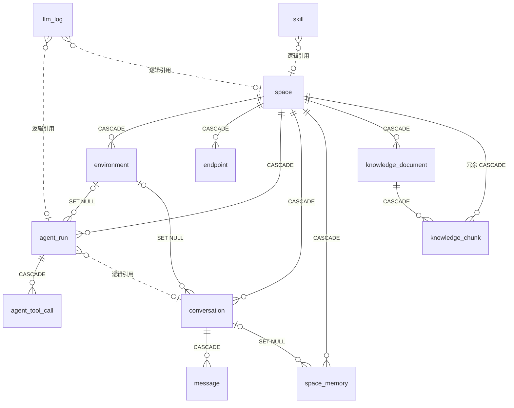

# 实体关系图

> 版本：v2.0（对应当前 ORM，12 张表）
> 定位：从关系视角描述表与表之间的连接方式，包括**数据库层强制的外键**与**只存在于代码中的逻辑引用**。
> 字段级定义见[数据库设计](DatabaseDesign.md)。
>
> 说明：旧版本图中的 `test_run` / `test_case` / `test_result` / `test_summary` / `report`
> 五张表已由迁移脚本删除（`v3` / `v4`），其职责由 `agent_run` 与 `agent_tool_call` 承接。

---

## 一、实体关系总览

实线关系为**真实外键**，标注的是 `ON DELETE` 行为；虚线关系为**逻辑引用**，只存 ID 列，不建约束。



读图要点：

| 关系 | 基数 | 删除行为 | 含义 |
|---|---|---|---|
| `space → environment` | 1:N | CASCADE | 空间是环境的归属主体 |
| `space → endpoint` | 1:N | CASCADE | 接口由空间独占，跨空间不可见 |
| `space → agent_run` | 1:N | CASCADE | 执行记录属于空间 |
| `space → conversation` | 1:N | CASCADE | 会话可无空间（`space_id` 可空），但删除空间会连带删会话 |
| `space → space_memory` | 1:N | CASCADE | 记忆按空间硬隔离 |
| `space → knowledge_document` | 1:N | CASCADE | 文档归属空间 |
| `space → knowledge_chunk` | 1:N | 冗余 CASCADE | 切片已可用 `document_id` 级联删除，这里的第二个外键是为了让「按空间清理」只需一次删除 |
| `environment → agent_run` | 1:N | SET NULL | 环境是可替换的配置，删环境不该删执行历史 |
| `environment → conversation` | 1:N | SET NULL | 同上 |
| `agent_run → agent_tool_call` | 1:N | CASCADE | 轨迹依附于执行记录，记录删了轨迹无意义 |
| `conversation → message` | 1:N | CASCADE | 消息依附于会话 |
| `conversation → space_memory` | 1:N | SET NULL | 记忆的来源会话可以消失，记忆本身要留下 |
| `knowledge_document → knowledge_chunk` | 1:N | CASCADE | 切片依附于文档 |

---

## 二、逻辑引用：为什么不建外键

四组关系在图上画成虚线，它们在模型里只是普通 `Integer` 列。这不是遗漏，是取舍。

| 引用 | 列 | 不建外键的理由 |
|---|---|---|
| `agent_run.conversation_id` | 可空 | 会话创建失败时执行记录仍要写入。留痕的价值高于引用完整性 |
| `llm_log.space_id` / `conversation_id` / `run_id` | 可空 | 成本账本必须在业务数据删除后依然可对账。CASCADE 会连历史成本一起抹掉，SET NULL 会变成无法归因的孤儿行 |
| `skill.space_id` | 可空 | 文件系统才是技能的真源。目录被手工删掉后，有外键会阻塞写入；无外键时脏行可由下次同步清掉 |

共同的判断标准：**这份数据的价值是否独立于被引用对象的存在**。会计算、审计类数据（成本、轨迹、记忆来源）
取「独立」，业务配置类数据（环境、文档）取「跟随」。

---

## 三、域分组拓扑

按职责把 12 张表分成四域。箭头表示写入依赖方向，不是外键方向。

```mermaid
flowchart TB
  subgraph SPEC["配置域"]
    space[("space")]
    env[("environment")]
    ep[("endpoint")]
    space --> env
    space --> ep
  end

  subgraph CHAT["对话域"]
    conv[("conversation")]
    msg[("message")]
    conv --> msg
  end

  subgraph RUN["执行域"]
    run[("agent_run")]
    call[("agent_tool_call")]
    log[("llm_log")]
    run --> call
    run -.->|"run_id 归因"| log
  end

  subgraph KNOW["知识与技能域"]
    doc[("knowledge_document")]
    chunk[("knowledge_chunk")]
    mem[("space_memory")]
    skill[("skill")]
    doc --> chunk
  end

  space -->|"隔离边界"| conv
  space -->|"隔离边界"| run
  space -->|"隔离边界"| KNOW
  skill -.->|"space_id 逻辑引用"| space
```

四域的边界值得单独说明：

- **配置域**回答「测什么、打到哪」：空间、环境、接口定义。写入来源是 OpenAPI 解析与用户手工配置。
- **对话域**回答「用户说了什么、Agent 回了什么」：只追加，不修改。工具调用轨迹**不在**这里。
- **执行域**回答「这一轮怎么得出结论、花了多少钱」：`agent_run` 是一轮的总账，
  `agent_tool_call` 是明细，`llm_log` 是计费流水。三者通过 `run_id` 串起来，
  但 `llm_log.run_id` 只是逻辑列，删除执行记录不会删账单。
- **知识与技能域**回答「Agent 能参考什么、能按什么方法论干活」：知识库是内容，技能是方法论，
  跨会话记忆是结论沉淀。

---

## 四、一次对话会写入哪些表

理解关系最直接的方式是看写入顺序。一轮 `POST /api/v1/chat/stream` 涉及的表：

| 顺序 | 表 | 动作 | 说明 |
|---|---|---|---|
| 1 | `conversation` | 可能 INSERT | 无 `conversation_id` 时新建 |
| 2 | `message` | INSERT | `role='user'`，先落库再推理 |
| 3 | `agent_run` | INSERT | 状态 `running`，`conversation_id` 可空 |
| 4 | `agent_tool_call` | INSERT × N | 每次工具调用一行，随执行逐步写入 |
| 5 | `llm_log` | INSERT × N | 每轮模型调用一行，`run_id` 指向第 3 步 |
| 6 | `agent_run` | UPDATE | 收尾时写入状态、统计列与 `cost_usd` |
| 7 | `message` | INSERT | `role='assistant'`，仅在正常收尾时写入 |

`space_memory` 的写入由 Agent 主动调用 `remember` 工具触发，不在这条主链路上。

---

## 五、删除传播

删除一个空间，数据库侧会连带删除：`environment`、`endpoint`、`agent_run`（进而 `agent_tool_call`）、
`conversation`（进而 `message`）、`space_memory`、`knowledge_document`（进而 `knowledge_chunk`）。

**不受影响**：`llm_log` 的全部行（含其 `space_id`）、`skill` 的空间级行（无外键，靠同步清理）。

磁盘侧：`workspaces/{id}/` 被重命名为 `workspaces/.deleted-{id}-{时间戳}`，不物理删除。
数据库里删干净、磁盘上留现场，两者是有意的非对称处理。

---

## 六、修订记录

| 日期 | 说明 |
|---|---|
| 2026-11-04 | v2.0：按当前 ORM 重绘。移除 `test_run` / `test_case` / `test_result` / `test_summary` / `report`；新增 `agent_run` / `agent_tool_call`；补 `llm_log.run_id` 逻辑引用与四域拓扑；删除 PlantUML 副本（Mermaid 为唯一图源） |
| 2026-10-21 | v0.2：新增记忆/知识库/技能四表，补 `llm_log` |
| 2026-08-27 | v0.1：`project` → `space` 术语同步 |
