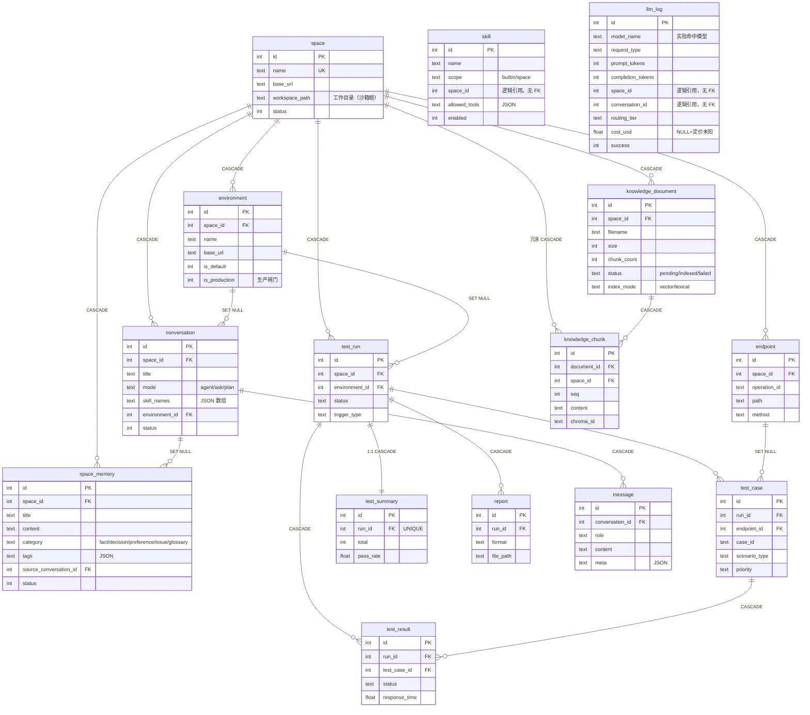
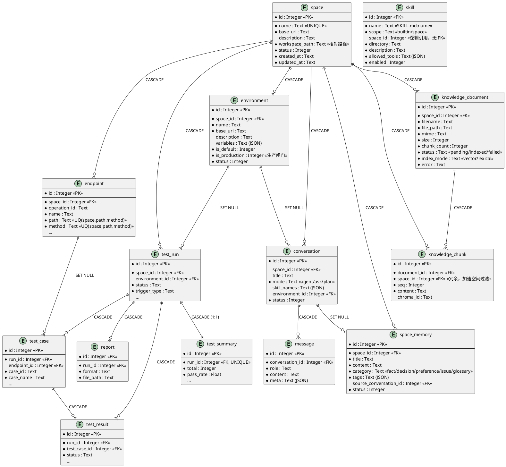
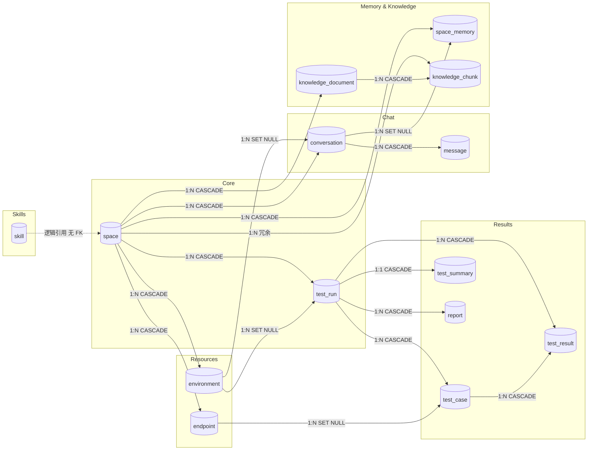
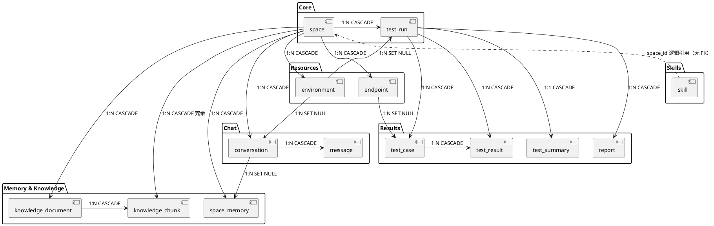

# 数据库实体关系图

> 版本：v0.2（对应 v1.0 重构后的实现，2026-10-20）
>
> 本次新增 4 张表（`space_memory` / `knowledge_document` / `knowledge_chunk` / `skill`）、3 组字段
> （`space.workspace_path`、`environment.is_production`、`conversation.skill_names` + `environment_id`），
> 并把 `conversation.mode` 的取值从 `Ask/Plan/Run` 改为小写 `agent/ask/plan`。
> 表字段级定义见 [数据库设计](DatabaseDesign.md)。

---

## 一、实体关系总览

> `llm_log` 的 `space_id` / `conversation_id` 是**逻辑引用，不建外键**：
> 统计表要能挺过空间删除与会话清理——加 CASCADE 会连历史成本一起删掉，
> 加 SET NULL 则变成无法归因的孤儿行。成本是要对账的，不该随业务数据消灭。

> 图中只画关键字段；字段级完整定义见 [数据库设计](DatabaseDesign.md)。同一张图的 PlantUML 源见
> `doc/images/er-diagram.puml`（用于导出更大尺寸的 SVG）。

同图 PlantUML 源（`doc/images/*.puml`，可用于导出 SVG）

---

## 二、关系详解

| 主表                   |  关系   | 从表                   | 外键                                | 删除策略     |
|----------------------|:-----:|----------------------|-----------------------------------|----------|
| `space`              | 1 : N | `environment`        | `environment.space_id`            | CASCADE  |
| `space`              | 1 : N | `endpoint`           | `endpoint.space_id`               | CASCADE  |
| `space`              | 1 : N | `test_run`           | `test_run.space_id`               | CASCADE  |
| `space`              | 1 : N | `conversation`       | `conversation.space_id`（可空）       | CASCADE  |
| `space`              | 1 : N | `space_memory`       | `space_memory.space_id`           | CASCADE  |
| `space`              | 1 : N | `knowledge_document` | `knowledge_document.space_id`     | CASCADE  |
| `space`              | 1 : N | `knowledge_chunk`    | `knowledge_chunk.space_id`（冗余）    | CASCADE  |
| `environment`        | 1 : N | `test_run`           | `test_run.environment_id`         | SET NULL |
| `environment`        | 1 : N | `conversation`       | `conversation.environment_id`     | SET NULL |
| `test_run`           | 1 : N | `test_case`          | `test_case.run_id`                | CASCADE  |
| `test_run`           | 1 : N | `test_result`        | `test_result.run_id`              | CASCADE  |
| `test_run`           | 1 : 1 | `test_summary`       | `test_summary.run_id` (UNIQUE)    | CASCADE  |
| `test_run`           | 1 : N | `report`             | `report.run_id`                   | CASCADE  |
| `endpoint`           | 1 : N | `test_case`          | `test_case.endpoint_id`           | SET NULL |
| `test_case`          | 1 : N | `test_result`        | `test_result.test_case_id`        | CASCADE  |
| `conversation`       | 1 : N | `message`            | `message.conversation_id`         | CASCADE  |
| `conversation`       | 1 : N | `space_memory`       | `space_memory.source_conversation_id` | SET NULL |
| `knowledge_document` | 1 : N | `knowledge_chunk`    | `knowledge_chunk.document_id`     | CASCADE  |

**无外键的表**：`skill`。它的 `space_id` 只是逻辑归属（`builtin` 时为空，`space` 时指向某空间），
不建 FK 约束——技能目录是文件系统里的真源，DB 行只是「发现结果 + 启用开关」的缓存，
强行建 FK 会让「目录已删、DB 还挂着」这种不一致变成写入失败。

---

## 三、关系拓扑图

同图 PlantUML 源（`doc/images/*.puml`，可用于导出 SVG）

---

## 四、实体清单

| 表名                   | 模型文件                              | 职责                                     |
|----------------------|-----------------------------------|----------------------------------------|
| `space`              | `src/data/models/space.py`        | 工作空间，管理多个被测服务；一行对应磁盘上一个工作目录（沙箱根）        |
| `environment`        | `src/data/models/environment.py`  | 测试环境；`is_production=1` 时 Agent 的写操作会被硬拦 |
| `endpoint`           | `src/data/models/endpoint.py`     | OpenAPI 解析后的 API 定义                    |
| `test_run`           | `src/data/models/test_run.py`     | 执行批次，关联配置快照与执行环境                       |
| `test_case`          | `src/data/models/test_case.py`    | 测试用例（LLM 生成 / 手工 / 导入）                 |
| `test_result`        | `src/data/models/test_result.py`  | 用例执行结果（请求/响应全量记录）                      |
| `test_summary`       | `src/data/models/test_summary.py` | 批次聚合摘要（1:1）                            |
| `report`             | `src/data/models/report.py`       | 报告文件记录                                 |
| `conversation`       | `src/data/models/conversation.py` | 会话元数据（`agent` / `ask` / `plan` + 技能 + 环境） |
| `message`            | `src/data/models/message.py`      | 会话消息（append-only）                       |
| `space_memory`       | `src/data/models/space_memory.py` | 跨会话记忆（DB 为真源，镜像到工作目录 `memory/MEMORY.md`） |
| `knowledge_document` | `src/data/models/knowledge.py`    | 知识库文档（上传后的切片索引状态）                      |
| `knowledge_chunk`    | `src/data/models/knowledge.py`    | 文档切片（`chroma_id` 记录向量库侧 ID）             |
| `skill`              | `src/data/models/skill.py`        | 技能发现结果与启用开关（文件系统为真源）                   |
| `llm_log`            | `src/data/models/llm_log.py`      | LLM 调用统计（模型 / tokens / 耗时 / 路由档位 / 成本），按空间与会话归因；归因列无外键 |

---

## 五、设计要点

### 删除策略

- **CASCADE** — 父记录删除时，子记录一同清除。用于强依赖关系（如 TestRun 删除时清除其所有用例和结果）。
- **SET NULL** — 父记录删除时，子记录外键置空。用于弱引用关系（如环境删除后 TestRun 保留但断开关联）。
- ⚠️ 注意：`space → test_run` 为 **CASCADE**（旧版为 SET NULL）——空间删除会连带删除其全部执行记录，如需保留历史请先导出报告。
- ⚠️ 空间删除时，工作目录**不删除**而是移入 `backend/workspaces/.archive/`（`WorkspaceManager.archive`），
  意图是「删库不删证据」，方便事后取证。

### 唯一约束

- `space.name` — 空间名全局唯一
- `(endpoint.space_id, endpoint.path, endpoint.method)` — 同一空间下接口路径+方法唯一
- `test_summary.run_id` — 每次测试运行仅有一条汇总记录

### 取值约束（CHECK）

| 约束名                       | 表                    | 规则                                                       |
|---------------------------|----------------------|----------------------------------------------------------|
| `ck_conversation_mode`    | `conversation`       | `mode IN ('agent','ask','plan')`                          |
| `ck_conversation_status`  | `conversation`       | `status IN (0,1)`                                        |
| `ck_memory_category`      | `space_memory`       | `category IN ('fact','decision','preference','issue','glossary')` |
| `ck_memory_status`        | `space_memory`       | `status IN (0,1)`                                        |
| `ck_document_status`      | `knowledge_document` | `status IN ('pending','indexed','failed')`                |
| `ck_document_index_mode`  | `knowledge_document` | `index_mode IN ('vector','lexical')`                      |
| `ck_skill_scope`          | `skill`              | `scope IN ('builtin','space')`                            |
| `ck_skill_enabled`        | `skill`              | `enabled IN (0,1)`                                       |

> `ck_conversation_mode` 从 `('Ask','Plan','Run')` 改为 `('agent','ask','plan')` 是一次**破坏性变更**：
> SQLite 无法直接改 CHECK，`v2_agent_migration` 用「`PRAGMA foreign_keys=OFF` → 建新表 → 拷数据 → 删旧表 → 改名 → 重跑索引」
> 完成重建，并有 `tests/data/test_migration_v2.py` 锁死「重建不能丢 message」。

### ID 生成

- 所有表主键由应用层雪花算法生成（`src/utils/id.py::next_id`），非数据库自增。

### 常用视图

| 视图                        | 用途                                   |
|---------------------------|--------------------------------------|
| `v_run_overview`          | 执行批次概览（关联空间、环境）                      |
| `v_api_pass_rate`         | 接口维度聚合（URL+Method 通过率、响应时间）          |
| `v_scenario_distribution` | 场景类型分布（normal / param_missing 等覆盖情况） |

---

## 六、变更记录

| 日期         | 变更                                                                                                                                                                                    |
|------------|---------------------------------------------------------------------------------------------------------------------------------------------------------------------------------------|
| 2026-10-20 | v1.0 重构：新增 `space_memory` / `knowledge_document` / `knowledge_chunk` / `skill` 4 表；新增 `space.workspace_path`、`environment.is_production`、`conversation.skill_names` + `environment_id`；`conversation.mode` 取值改为小写 `agent/ask/plan`（含表重建迁移）；补齐 CHECK 约束清单 |
| 2026-08-27 | 同步 `project → space` 术语层重命名；`test_run.space_id` 删除策略 SET NULL → CASCADE；新增 `conversation` / `message` 会话消息表；补充视图与设计要点                                                          |
| 旧版         | 初始版本（project 术语）                                                                                                                                                                       |

---

*📎 相关文档：[系统流程图](SystemFlowchart.md) · [数据库设计](DatabaseDesign.md)*
