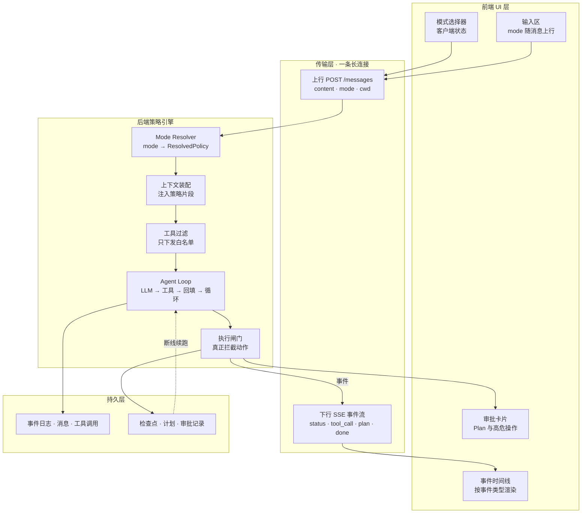
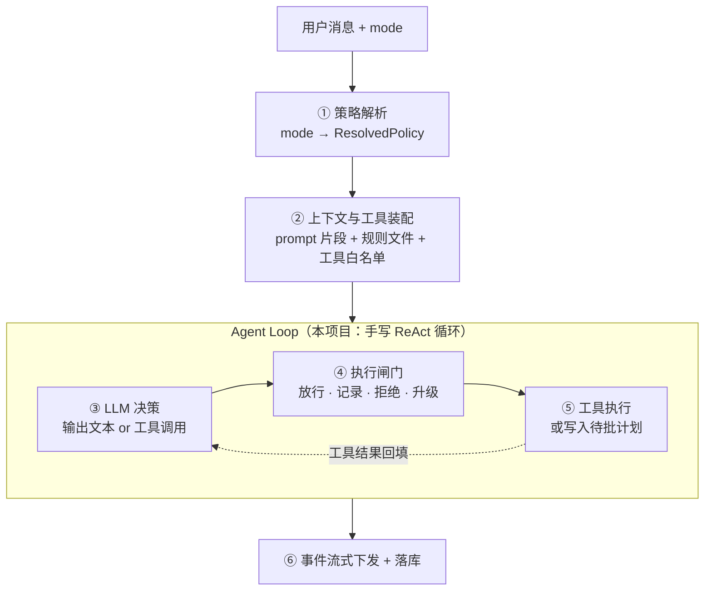

# TestAgents 模式功能（Mode）设计文档

> 版本：v0.2.0
> 定位：描述 Agent / Plan / Ask 三种工作模式在前端展示、传输协议、后端处理上的完整实现方式。
> 状态：✅ **核心已落地**（2026-10-20，v1.0 重构）。§一~§五 描述的分层流转与「强制点在执行路径」已按本文实现；
> 未落地项集中在人工审批与事件持久化，逐条对照见 [§九](#九设计--实现对照)。
> 历史差距快照（落地前）见 [模式功能差距分析](Mode-System-Gap-Analysis.md)。
>
> 与其他文档关系：[架构设计](Architecture.md)、[数据库设计](DatabaseDesign.md)、[页面设计准则](UI-Design-Guidelines.md)、
> [系统流程图](SystemFlowchart.md)。

---

## 一、核心结论

**「模式」不是换一套 prompt，而是同一个请求管线上的四个层面同时切换：**

```
UI 状态  →  请求参数  →  后端策略对象  →  运行时执行闸门
```

前三层是**提示（advisory）**，只有第四层是**强制（enforced）**。

最常见的错误做法是"给 system prompt 加一句话说明当前模式"。这样做的结果是：模型在 Ask 模式下仍然会调用写文件工具，因为工具列表里有它，而 prompt 里的约束只是建议。**模式必须落到执行路径上的拦截点才有意义。**

---

## 二、分层流转



---

## 三、前端实现

### 3.1 状态与交互

模式是一个**客户端状态**（zustand / Redux / 组件 state），用分段控件（segmented control）或下拉菜单呈现，并持久化到 `localStorage`。

模式需要影响的 UI 表现点：

| 表现点 | 说明 |
|---|---|
| 输入框 placeholder | 不同模式给不同示例（"描述要测的接口" vs "描述要规划的测试范围"） |
| 发送按钮文案 | `发送` / `生成计划` |
| 危险操作二次确认弹窗 | 仅 Agent 模式触发 |
| 消息流中的组件类型 | Agent 渲染工具调用块 + 产物卡片；Plan 渲染计划清单 + 批准按钮；Ask 只渲染纯文本 |
| 输入框禁用/中断入口 | 流式执行中显示停止按钮 |

### 3.2 mode 必须随每条消息上行

**不要只在建会话时发送一次 mode。** 用户会在会话中途切换模式（先让它规划 → 看完计划 → 切 Agent 执行），所以每轮请求都要带上当前 mode：

```jsonc
POST /api/v1/spaces/{space_id}/messages
{
  "content": "为登录接口设计一组测试用例",
  "mode": "plan",
  "conversation_id": 123456789,
  "cwd": "/abs/path/to/workspace",
  "attachments": [],
  "context_refs": ["@doc/api/login.yaml"]
}
```

> ⚠️ 前端传上来的 mode 只是**用户体验参数**，后端必须做权限上限校验后再落库，绝不能直接信任。

### 3.3 渲染：事件归约，而非字符串拼接

后端返回的不是一段完整回复，而是一串**带类型的事件**。正确做法是用纯函数 reducer 把事件归约成时间线节点数组：

```typescript
type TimelineNode =
  | { kind: "text"; id: string; content: string }
  | { kind: "tool_call"; id: string; name: string; args: unknown; result?: string; collapsed: boolean }
  | { kind: "plan"; id: string; steps: PlanStep[]; status: "pending" | "approved" | "rejected" }
  | { kind: "permission"; id: string; request: PermissionRequest; status: "waiting" | "granted" | "denied" }
  | { kind: "artifact"; id: string; path: string; mime: string }
  | { kind: "status"; id: string; label: string }
  | { kind: "error"; id: string; message: string };

function reduce(prev: TimelineNode[], ev: AgentEvent): TimelineNode[];
```

**事件类型 → UI 节点对照表：**

| 事件类型 | UI 行为 |
|---|---|
| `status` | 在当前气泡外挂阶段说明（"正在分析数据"） |
| `text_delta` | 追加到当前文本块 |
| `tool_call` | 新增一个可折叠的调用卡片（含入参） |
| `tool_result` | 回填到对应折叠卡片 |
| `plan` | 插入计划清单组件（可勾选、可批准） |
| `permission_request` | 插入阻塞式审批卡片，等待用户点击 |
| `artifact` / `file_change` | 右侧结果区新增产物条目 |
| `error` / `done` | 终止当前气泡的 loading 态 |

**这样做的收益**：断线重连时只要按 `seq` 补发缺失事件，UI 状态自动收敛，无需专门编写"恢复逻辑"。而字符串拼接方案在流式中断后必然出现内容错乱或重复。

---

## 四、传输协议：SSE 事件规范

### 4.1 为什么是 SSE 而不是 WebSocket

| 维度 | SSE | WebSocket |
|---|---|---|
| 方向 | 单向（服务端推送） | 双向 |
| 代理/网关 | 标准 HTTP，无需粘性会话 | 需要粘性会话，水平扩容困难 |
| 断线重连 | 浏览器原生支持 + `Last-Event-ID` | 需自行实现 |
| 适用性 | ✅ Agent 执行是"提交 → 观察"，天然单向 | 仅当需要运行中双向插话时才需要 |

### 4.2 架构决策：任务生命周期不绑在 HTTP 连接上

**不要让 HTTP 连接承载 Agent 任务的生命周期。** 正确做法：

1. Agent Loop 把事件写入**会话级 event log**（DB 表 或 Redis Stream）
2. SSE 端点只做「订阅 + 转发」
3. 客户端断线 / 刷新 / 切走，任务照常执行
4. 重连时携带 `Last-Event-ID`，按 `seq` 补发缺失事件

### 4.3 事件帧格式

```
id: 42
event: tool_call
data: {"seq":42,"type":"tool_call","name":"send_request","args":{...},"ts":1758900000}

```

三个字段都必须有：

- `id:` — 事件序号，支撑 `Last-Event-ID` 断点续传
- `event:` — 事件类型，便于前端 `EventSource.addEventListener` 分发（也可统一走 `data.type`）
- `data:` — JSON payload

**必须设置的响应头**：

```
Content-Type: text/event-stream; charset=utf-8
Cache-Control: no-cache
X-Accel-Buffering: no          # 不加这条，nginx 会把整条流攒完再一次性吐出
Connection: keep-alive
```

### 4.4 事件类型清单

| 类型 | 载荷 | 说明 |
|---|---|---|
| `start` | `{turn_id}` | 一轮开始 |
| `status` | `{label}` | 阶段说明 |
| `text_delta` | `{content}` | 文本增量 |
| `thinking_delta` | `{content}` | 推理增量（可选，可折叠） |
| `tool_call` | `{name, args, call_id}` | 工具调用请求 |
| `tool_result` | `{call_id, ok, content}` | 工具执行结果 |
| `plan` | `{steps[]}` | 计划产物（Plan 模式） |
| `permission_request` | `{request_id, action, risk}` | 请求人工确认 |
| `permission_resolved` | `{request_id, granted}` | 确认结果 |
| `artifact` | `{path, mime}` | 产物生成 |
| `file_change` | `{path, op}` | 文件变更 |
| `error` | `{message}` | 错误 |
| `done` | `{usage}` | 一轮结束 |

---

## 五、后端处理管线



### 5.1 ① 策略解析（Mode Resolver）

这是整个功能的支点。mode 是一个字符串，必须被翻译成一个**冻结的策略对象**：

```python
from dataclasses import dataclass
from enum import Enum
from typing import Literal

class Gate(Enum):
    ALLOW = "allow"        # 直接执行
    RECORD = "record"      # 只写进计划，不执行
    DENY = "deny"          # 拒绝，并把原因回填给模型
    ESCALATE = "escalate"  # 挂起，等用户确认

@dataclass(frozen=True)
class ResolvedPolicy:
    mode: Literal["agent", "plan", "ask"]
    allowed_tools: frozenset[str]   # 决定发给 LLM 的工具列表
    mutating_tools: frozenset[str]  # 需要走闸门判定的工具
    gate: Gate                      # 闸门默认判定
    require_plan_approval: bool     # 是否输出计划后暂停
    max_steps: int                  # 步数预算
    prompt_fragment: str            # 注入 system prompt 的策略说明
```

**合并顺序**：`系统默认值 ← 组织/用户配置 ← 会话当前 mode ← 单次请求 override`

用 `frozen dataclass` 而不是 dict，是为了让 `policy.allowed_tools` 成为整条链路上**唯一可信的来源**。

> ⚠️ **mode 必须在每一轮重新解析**，不能缓存在 Session 对象里，否则中途切模式不生效。

### 5.2 ② 上下文与工具装配

`system prompt` 的拼装顺序：

```
基础人格/角色定义
  + policy.prompt_fragment          ← 按模式注入的策略说明
  + 项目规则文件（AGENTS.md / 规范文档）
  + 长期记忆摘要
  + 实际允许的工具说明书             ← 注意这一项
```

最后一项是关键：**Ask 模式下，写文件工具的 schema 根本不进请求**。模型连"这个能力存在"都不知道。这比在 prompt 里写"你不许写文件"有效得多。

### 5.3 ③ Agent Loop

循环体是「LLM → 工具 → 回填」一圈。本项目的实现是一段 `for step in range(max_steps)`（`src/agent/runner.py`），
没有图、没有条件边——是否需要下一圈由 `AIMessage.tool_calls` 是否为空直接决定。

必须在这一层兜底：

- 最大步数（`max_steps`）
- 单轮超时（`asyncio.wait_for`）
- token / 成本预算
- 循环检测（连续 N 次相同工具+参数 → 中断）

> **超时处理约定**：超时时**不要抛异常**。应当发出 `partial` 事件，携带已完成的部分结果 + `truncated: true` 标记。用户能拿到半成品，远好过一个 504。

### 5.4 ④ 执行闸门（唯一的强制点）

所有工具调用在真正执行前必经的唯一入口。**这是模式功能能不能生效的决定性环节。**

> 🔑 **核心设计约定：权限不足时不要抛异常，要返回一条结构化的「工具结果」。**
>
> 抛异常会炸掉整个 loop；返回 tool result 则让模型看到"我缺少写权限"，进而主动向用户解释并给出替代方案。**Ask 模式的体验好坏全在这一个细节上。**

四种判定分支：

| 判定 | 触发条件 | 行为 |
|---|---|---|
| `ALLOW` | 命中白名单且非高危 | 直接执行 |
| `RECORD` | Plan 模式遇到 mutating 工具 | 不执行，把 `{tool, args, 意图}` 追加进 plan buffer，继续循环让模型补全计划 |
| `DENY` | 工具不在 `allowed_tools` | 返回 error tool result，提示模型改用文字说明 |
| `ESCALATE` | 高危操作（越出 cwd 的写、`rm`、未授权网络） | 发出 `permission_request` 事件并挂起，落库检查点，等确认后用 resume token 恢复 |

### 5.5 ⑤⑥ 流式下发与落库

```python
# 提交与订阅分离
@app.post("/spaces/{sid}/messages")
async def send(sid: str, body: MessageIn, user=Depends(auth)):
    turn = await store.create_turn(sid, body.content, body.mode, user.id)
    asyncio.create_task(run_agent_loop(turn))     # 后台执行，连接断了也不停
    return {"turn_id": turn.id}

# 订阅端点：支持 Last-Event-ID 断点续传
@app.get("/spaces/{sid}/turns/{tid}/events")
async def events(sid: str, tid: str, last_event_id: str | None = Header(None)):
    async def gen():
        async for ev in store.subscribe(tid, after=last_event_id):
            yield f"id: {ev.seq}\nevent: {ev.type}\ndata: {json.dumps(ev.payload)}\n\n"
            if ev.type in ("done", "error"):
                return
    return StreamingResponse(gen(), media_type="text/event-stream", headers={
        "Cache-Control": "no-cache",
        "X-Accel-Buffering": "no",
        "Connection": "keep-alive",
    })
```

**落库对象**（缺一不可，否则无法支撑续跑、历史回放与审计）：

- 消息（user / assistant）
- 事件日志（含 seq）
- 工具调用记录
- 计划与审批记录
- 检查点（可恢复的会话状态；LangGraph 用 checkpointer，本项目尚未实现）

---

## 六、三种模式差异矩阵

**三种模式只改四个地方，管线是同一套。**

| 能力维度 | Agent 模式 | Plan 模式 | Ask 模式 |
|---|---|---|---|
| 读取 · 搜索 | 允许 | 允许 | 允许 |
| 写文件 · 跑命令 | **允许** | **仅记录到计划** | **阻止** |
| 一轮结束形态 | 交付结果 | 计划待批准 | 只回答不动手 |
| 人工确认点 | 仅高危操作 | 批准计划后执行 | 无 |
| 定位 | 落地执行 | 方案评审 | 咨询问答 |

> ⚠️ **Plan 模式不能靠"过滤掉写工具"来实现**——那样模型无法规划出写操作。
>
> 正确做法：**写工具的 schema 照给，闸门判 `RECORD`。** 这是最常做反的一点。

对应的策略表：

```python
POLICIES = {
    # Plan 模式仍然保留写工具 schema（否则模型无法规划）
    "agent": ResolvedPolicy("agent", READ | WRITE | EXEC, MUTATING,
                            Gate.ALLOW, approve_plan=False, max_steps=40, prompt_fragment=AGENT_FRAGMENT),
    "plan":  ResolvedPolicy("plan",  READ | WRITE | EXEC, MUTATING,
                            Gate.RECORD, approve_plan=True,  max_steps=30, prompt_fragment=PLAN_FRAGMENT),
    "ask":   ResolvedPolicy("ask",   READ,                MUTATING,
                            Gate.DENY,   approve_plan=False, max_steps=8,  prompt_fragment=ASK_FRAGMENT),
}
```

---

## 七、参考实现：执行闸门

```python
async def run_gate(call: ToolCall, policy: ResolvedPolicy, ctx: TurnContext) -> ToolResult:
    # 1) 工具不在白名单 → 拒绝，但返回 tool result（不抛异常）
    if call.name not in policy.allowed_tools:
        return ToolResult.error(
            f"当前为 {policy.mode} 模式，{call.name} 未开放。"
            "请用文字说明打算做什么，由用户决定是否切换模式。"
        )

    # 2) 变更类工具 + 非 ALLOW 闸门 → RECORD 或 DENY
    if call.name in policy.mutating_tools and policy.gate is not Gate.ALLOW:
        if policy.gate is Gate.RECORD:
            ctx.plan.append(PlanStep(tool=call.name, args=call.args, intent=ctx.current_intent))
            return ToolResult.ok(f"已记入计划（未执行）：{call.name}")
        return ToolResult.error("该动作需要写权限，已阻止。")

    # 3) 高危操作 → 挂起等人工确认
    if is_dangerous(call, ctx.cwd):
        await ctx.emit("permission_request", redact(call))
        approval = await ctx.wait_approval()        # ← 挂起点（需检查点支撑）
        if not approval.granted:
            return ToolResult.error("用户拒绝了该操作。")

    return ToolResult.ok(await dispatch(call))
```

**Plan 模式批准后的续跑流程：**

```
Plan 轮次：LLM 规划 → 闸门 RECORD → plan buffer 累积 → 输出 plan 事件 → 落库检查点 → 结束本轮
                                          ↓
用户点击「批准」→ POST /turns/{tid}/approve {resume_token}（幂等）
                                          ↓
后端从检查点恢复 → mode 提升为 agent（仅本轮）→ 执行 plan buffer 中的步骤 → 继续 loop
```

---

## 八、工程注意事项

| # | 陷阱 | 后果 | 正确做法 |
|---|---|---|---|
| 1 | Plan 模式过滤掉写工具 | 模型无法规划写操作 | schema 照给，闸门判 `RECORD` |
| 2 | 无状态检查点 | 批准后第二次 HTTP 请求里没有上下文，无法续跑 | 落 `conversation_event` 让事件可重放，再做续跑 |
| 3 | 审批无幂等 token | 用户连点两次，执行两遍 | `resume_token` + 幂等消费 |
| 4 | 子代理权限放大 | Ask 模式里起一个子代理即可越权写文件 | 强制 `child.allowed_tools ⊆ parent.allowed_tools` |
| 5 | 信任前端 mode | 绕过前端即可提权 | 服务端反查用户/组织权限上限 |
| 6 | 工具列表变化打乱 prompt 缓存 | prompt cache 命中率下降，成本上升 | 把按模式变化的部分放在缓存断点之后 |
| 7 | 权限拒绝抛异常 | 整个 loop 崩溃，用户只看到报错 | 返回 error tool result |
| 8 | SSE 未禁缓冲 | 网关攒完整条流再一次性吐出，失去流式意义 | `X-Accel-Buffering: no` |
| 9 | 在 Agent loop 里用同步阻塞 IO | 阻塞 asyncio 事件循环，拖垮所有并发用户 | 全部改用 `httpx.AsyncClient` / async DB driver |

---

## 九、设计 ↔ 实现对照

本节的原始形态是「落地建议」（当时代码还在 LangGraph 上）。v1.0 重构后逐条核对如下：

| 设计概念 | 落点（重构后） | 状态 | 说明 |
|---|---|:--:|---|
| `ResolvedPolicy` / `resolve_policy()` | `src/agent/modes.py`：`ModePolicy` + `policy_for()` | ✅ | 纯函数，无 IO，可直接单测 |
| 工具过滤（schema 层不下发） | `filter_tools()` + `ToolBundle` | ✅ | `ask`/`plan` 只绑定 12 个只读工具 |
| 执行闸门（唯一强制点） | `runner._execute` 查 `tool_map`，缺失即 `unknown tool` | ✅ | 未单独抽 `gate.py`，收敛在 runner 内 30 行 |
| 统一 SSE（不按 mode 切 media type） | `POST /chat/stream`，固定 `text/event-stream` | ✅ | 六事件协议见 [SystemFlowchart.md](SystemFlowchart.md) §3.4 |
| SSE 禁缓冲 | `_SSE_HEADERS` 含 `X-Accel-Buffering: no` | ✅ | 同时设 `Cache-Control: no-cache` |
| 前端事件 reducer | `hooks/use-chat.ts` | ✅ | 维护「已落库消息 + 本轮 overlay」双状态 |
| `tool-call-card.tsx` | `components/chat/tool-call-card.tsx` | ✅ | 可折叠，含 ARGS / RESULT / 耗时 |
| `plan-card.tsx`（结构化计划卡） | — | ❌ | `plan` 模式目前输出**文字计划**，未结构化 |
| `permission-request-card.tsx`（审批卡） | — | ❌ | 无审批流 |
| Plan buffer / PlanStep + 落库 | — | ❌ | 无 `plan` / `plan_step` 表 |
| 审批续跑（`interrupt()` + checkpointer） | — | ❌ | 未引入 LangGraph，也无等价的状态检查点 |
| 事件日志表（`conversation_event`） | — | ❌ | 事件只在流里存在，落库的只有最终答案与 user 输入 |
| 服务端反查权限上限（不信任前端 mode） | — | ⚠️ | 目前 `mode` 由前端传入，服务端只做 `normalize_mode` 归一化，不校验提权 |

### 关于「Plan 模式过滤掉写工具」（§八 陷阱 1）

原文档建议「Plan 不要过滤写工具，schema 照给，闸门判 `RECORD`」。本项目**故意反着做**，原因是产品定位不同：

- 那套设计的前提是 Plan 执行完毕后要**续跑真实执行**，所以模型必须"看得见"写工具才能规划。
- 本项目的 `plan` 语义是「只输出测试计划供人看」，计划由人带走到 `agent` 模式重跑，
  不存在「plan 里排队等待执行」的步骤。因此过滤掉写工具是**更彻底的保证**——
  模型连表达"我要写文件"的能力都没有。

若未来补上审批续跑（§九 的 ❌ 项），这条取舍必须一起改回去，否则计划里的写操作会缺 schema。

### 未落地项的共同前提

三个 ❌ 项（审批卡 / 计划结构化 / 事件日志）其实指向同一个缺失：**会话状态缺一个可恢复的检查点**。
当前一轮请求的生命周期完全绑在 HTTP 连接上，连接断了就没有「这一轮跑到哪」的记录。
补齐路径：先加 `conversation_event` 表（`seq` / `type` / `payload`）让事件可重放，再谈审批与续跑。

---

## 十、参考资料

- 差距分析与现有代码对标：[Mode-System-Gap-Analysis.md](Mode-System-Gap-Analysis.md)
- LangGraph 人机协同：`interrupt()` / checkpointer
- SSE 规范：W3C EventSource / `Last-Event-ID`
