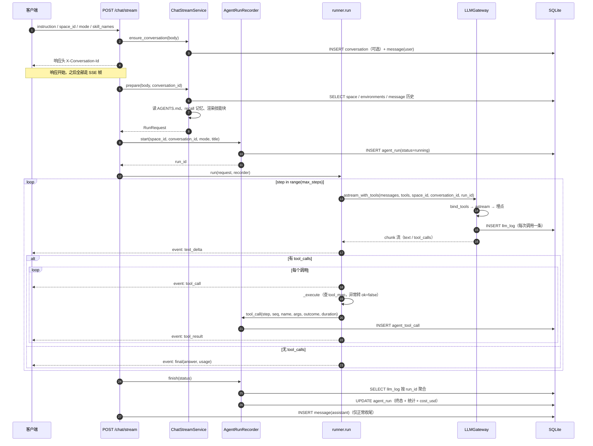

# 系统流程图

> 版本：v2.0（对应 `feature/web_ui` 分支当前实现）
> 定位：描述一轮对话从 HTTP 请求进入、到事件流结束、再到数据库落定的完整路径，
> 重点是**每个阶段的失败行为**——正常路径看代码就够，异常路径才需要文档。
>
> 关联文档：[架构设计](Architecture.md) · [数据库设计](DatabaseDesign.md) · [模式设计](Mode-System-Design.md)

---

## 一、总览

一轮对话经过五个阶段，只有第四个阶段调用大模型：

| 阶段 | 位置 | 调用 LLM | 产出 | 失败时的行为 |
|:--|---|---|---|---|
| ① 会话准备 | `ChatStreamService.ensure_conversation` | 否 | 会话 ID + user 消息落库 | 记日志，用原 ID 或 0 继续 |
| ② 上下文组装 | `ChatStreamService.prepare` | 否 | `RunRequest` | 结束流，发一条 `error` |
| ③ 记录开启 | `AgentRunRecorder.start` | 否 | `agent_run`（`running`）+ `run_id` | `run_id` 为 None，本轮不记账 |
| ④ 推理执行 | `agent/runner.py::run` | **是** | 事件流 | 内部异常转 `ok=false` 工具结果；模型层异常发 `error` |
| ⑤ 收尾落库 | `stream_answer` 的 `finally` | 否 | `agent_run` 终态 + assistant 消息 | 吞异常并记日志，不影响已下发内容 |

阶段 ③ 必须排在 ② 之后。若在装配失败前就建记录，`finally` 尚未建立，库里会留下一条永远
`running` 的行——既不会被清理任务识别为超时，也无法判断它是否真的执行过。

---

## 二、时序



---

## 三、阶段详解

### 3.1 会话准备

| 步骤 | 代码 | 说明 |
|---|---|---|
| 取或建会话 | `ensure_conversation` | 有 `conversation_id` 直接复用；无则按 `space_id` / `mode` / `skill_names` / `environment_id` 新建 |
| 落库用户输入 | 同上 | 先落库再推理：模型挂了，输入仍然可查 |
| 回传会话 ID | `api/v1/chat.py` | 响应头 `X-Conversation-Id`；前端拿到后写回 URL |
| 缺空间的处理 | `_missing_space_stream` | 不发 400，改为流内一条 `error` 帧。前端已在读流，帧比状态码更容易处理 |

### 3.2 上下文组装

`prepare()` 一次性把本轮所需的一切装进 `RunRequest`。所有外部读取都做了降级：

| 组成 | 来源 | 失败时的行为 |
|---|---|---|
| 空间快照 | `space` + 接口计数 + 环境清单 | 查不到给占位名，接口数记 0 |
| `AGENTS.md` | `workspaces/{id}/AGENTS.md` | 文件缺失则跳过该段 |
| 历史消息 | `message` 表升序，取最近 20 条 | 读失败按单轮处理 |
| 跨会话记忆 | `LongTermMemory.recall`（关键词 + LIKE） | 无命中则不注入 |
| 技能正文 | `SkillService.build_prompt_blocks` | 技能不存在则跳过并记日志 |

历史消息默认**剔除末尾的 user 消息**（`exclude_trailing_user=True`）。阶段 ① 已把本轮提问落库，
不剔除会让同一个问题在上下文里出现两次。

### 3.3 推理执行

见[架构设计](Architecture.md) §3.2 的循环骨架。此处补充三个易错点：

1. **`seq` 用局部计数器**。模块级全局变量会被并发的多轮对话互相污染，前端按 `seq` 排序就会错乱。
2. **工具记录写在 `finally` 里**。即使客户端在这一刻断流，也要留下「这个工具被调过」的证据；
   recorder 内部是短事务，不 `await`、不 `yield`。
3. **回灌模型的内容与下发前端的内容一致**。二者都经过 `_for_model` 截断，
   若只截一个，排障时会出现「模型说结果很长、前端只看到一半」的假象。

### 3.4 收尾

`finally` 块在两种语境下执行，行为不同：

| 语境 | `settled` | 记录终态 | assistant 消息 |
|---|:--:|---|---|
| 收到 `final` | true | `completed` | 落库 |
| 收到 `error` 或抛未捕获异常 | true | `failed` | 不落库 |
| 客户端断流（`GeneratorExit`） | false | `cancelled` | 不落库 |

在这个块里**不能 `await`**（会抛 `CancelledError`）、**不能 `yield`**（会抛 `RuntimeError`）、
**不能向外抛异常**（会覆盖 `GeneratorExit`）。这三个限制是 recorder 三个方法都定义为同步方法的原因。

---

## 四、SSE 帧格式

每帧三行加一个空行：

```
id: 7
event: tool_result
data: {"seq":7,"type":"tool_result","ts":null,"id":"call_1","name":"send_request","ok":true,"content":"...","duration_ms":183}

```

- `id`：帧序号，流内从 0 单调递增。当前未实现断点续传，`id` 为将来补 `Last-Event-ID` 预留。
- `event`：事件名，与 `data.type` 相同。两者都带，是为了兼容 `addEventListener` 与统一分发两种写法。
- `data`：JSON。序列化用 `default=str` 兜底，避免单个不可序列化的值打断整条流。

响应头：`Content-Type: text/event-stream`、`Cache-Control: no-cache`、`Connection: keep-alive`、
`X-Accel-Buffering: no`、`Access-Control-Expose-Headers: X-Conversation-Id`。

事件清单见[架构设计](Architecture.md) §3.5。

---

## 五、失败与中断

| 现象 | 根因 | 用户看到什么 | 记录里留下什么 |
|---|---|---|---|
| 模型调用失败 | 凭证无效、网络不可达、模型名错误 | 一条 `error` 帧，已输出的文本保留 | `agent_run.status=failed` + `error_message` |
| 工具执行失败 | 参数不合法、路径越界、生产环境拦截 | `tool_result` 但 `ok=false`，流继续 | `agent_tool_call.ok=0` + `error_type` |
| 工具名不存在 | 模型编造工具 | `tool_result` 含可用工具清单 | 同上，`error_type=not_found` |
| 超过最大轮次 | 模型陷入循环 | `error` 帧，提示轮次上限 | `status=failed` |
| 客户端断流 | 用户关页或切走 | 无（连接已断） | `status=cancelled` |
| 上下文装配失败 | 数据库不可用 | 一条 `error` 帧，无 `start` | **无记录**（记录在装配之后才建） |
| 缺 `space_id` | 前端未选空间 | 一条 `error` 帧，HTTP 200 | 无记录 |

最后两行是刻意的：装配阶段失败时还没有执行记录，因此查不到任何痕迹。
如果将来需要追溯这类失败，应当把记录创建提前到 `prepare` 之前并接受「可能留下 running 行」的代价。

---

## 六、与旧版流程的对照

旧版（LangGraph）已在 v1.0 重构中整体删除，此处仅保留结构性差别，便于理解为什么现在没有图：

| 维度 | 旧（LangGraph 工作流） | 现（手写 ReAct） |
|---|---|---|
| 流程形态 | 固定图：`START → parse_input → 分支 → 各节点 → END` | 单循环，拓扑由模型逐轮决定 |
| 意图识别 | 独立 LLM 节点分类 `run` / `ask` | 取消，用户直接选 `mode` |
| 用例生成 | 独立节点批量生成后落库 | 模型在循环内现调工具，产物写文件 |
| 工具可见性 | 所有节点共享同一套工具 | 按模式裁剪白名单，执行前再校验一次 |
| 流式粒度 | 节点级事件 | token 级 `text_delta` + 工具级事件 |
| 可回溯性 | 依赖外部 trace 服务 | 事件流 + `agent_tool_call` 自带轨迹，可离线回放 |

---

## 七、修订记录

| 日期 | 说明 |
|---|---|
| 2026-11-04 | v2.0：补执行记录阶段与时序图；`start` 载荷改为 `skills` + `run_id`；步数上限 12/8 → 100/80；补失败与中断对照表；移除 PlantUML 副本 |
| 2026-10-20 | v0.2：按 ReAct 运行时重写 |
