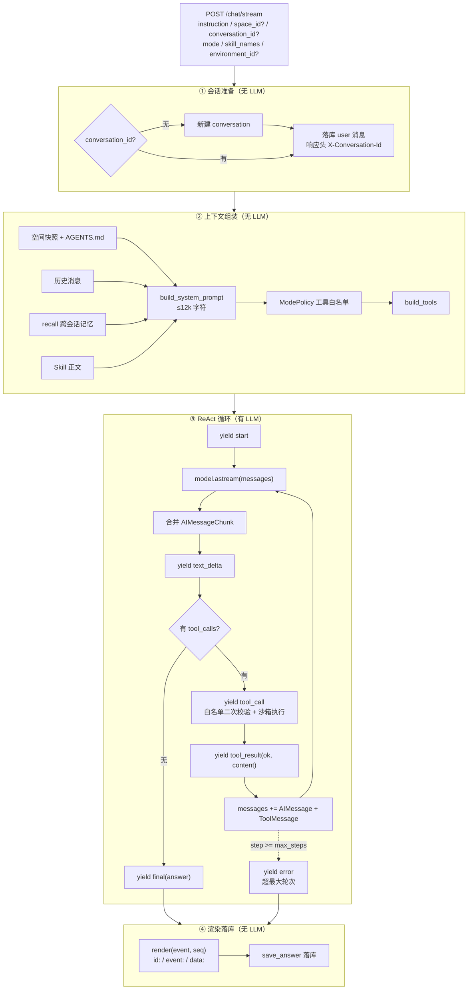
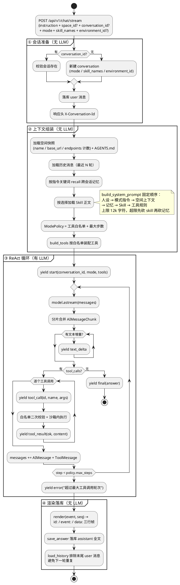

# 系统流程图 — TestAgents

> 版本：v0.2（对应 v1.0 重构后的实现，2026-10-20）
>
> **与 v0.1 的根本差别**：旧版描述的是 LangGraph 图（intent 路由 → 各节点 → 执行引擎）——
> 那套代码（`src/workflow.py`、`src/graph/**`）已在 v1.0 重构中整体删除。
> 现行运行时是一段**手写 ReAct 循环**（`src/agent/runner.py`），流程由「模式 → 工具白名单 → 循环」构成，
> 不再有意图分类节点、不再有固定图结构。历史设计见 [Architecture.md](Architecture.md) §三。

---

## 一、总览

一轮对话从 `POST /api/v1/chat/stream` 进入，经过四段**职责分离**的处理：

| 阶段 | 位置 | 是否调用 LLM | 产出 |
|:--|:--|:--:|:--|
| ① 会话准备 | `ChatStreamService.ensure_conversation` | ❌ | 会话 ID + user 消息落库 |
| ② 上下文组装 | `ChatStreamService.prepare` + `agent/context.py` | ❌ | `RunRequest`（system prompt + 工具集 + 策略） |
| ③ 推理执行 | `agent/runner.py` 的 ReAct 循环 | ✅ | 事件流（text / tool_call / tool_result） |
| ④ 渲染落库 | `api/v1/chat.py` + `save_answer` | ❌ | SSE 帧 + assistant 消息落库 |

**关键设计**：LLM 只出现在阶段 ③。阶段 ①④ 是纯确定性代码——这意味着「为什么这轮可用哪些工具」
可以完全离线复盘，不依赖模型自我报告（见 [Testing-Agent-Roadmap.md](Testing-Agent-Roadmap.md) 的两阶段分离原则）。

---

## 二、系统主流程



<details>
<summary>同图 PlantUML 源（`doc/images/system-flowchart.puml`，可用于导出 SVG）</summary>



</details>

---

## 三、阶段详解

### 3.1 会话准备

| 步骤 | 代码 | 说明 |
|:--|:--|:--|
| 取或建会话 | `ChatStreamService.ensure_conversation` | 有 `conversation_id` 直接复用；无则按 `space_id` / `mode` / `skill_names` / `environment_id` 新建 |
| 落库用户输入 | 同上 | 先落库再推理，保证「模型挂了也有输入记录」 |
| 头部回传 | `api/v1/chat.py` | `X-Conversation-Id` 让前端新建会话后立刻拿到 ID 写回 URL |

### 3.2 上下文组装

`prepare()` 一次性把本轮所需的一切装进 `RunRequest`：

| 组成 | 来源 | 失效时的行为 |
|:--|:--|:--|
| 空间快照 | `space` + `endpoint` 计数 + `AGENTS.md` | 空间不存在 → `error` 事件，不进入循环 |
| 历史消息 | `message` 表（升序） | 空则只有 system + 当前输入 |
| 跨会话记忆 | `LongTermMemory.recall`（关键词抽取后 LIKE） | 无命中则不注入 |
| Skill 正文 | `SkillService.build_prompt_blocks` | 技能名不存在 → 跳过并记日志 |
| 工具集 | `build_tools(space_id, mode, skill_names, ...)` | 白名单为空 → 模型无法调用工具，退化为纯问答 |

### 3.3 ReAct 循环

`src/agent/runner.py::run` 的骨架：

```python
yield StartEvent(...)
for step in range(policy.max_steps):
    accumulated = None
    async for chunk in model.astream(messages):
        accumulated = chunk if accumulated is None else accumulated + chunk   # 分片合并交给 LangChain
        if text := chunk.text: yield TextDeltaEvent(text)
    if not accumulated.tool_calls:
        yield FinalEvent(answer=accumulated.text)
        return
    for call in accumulated.tool_calls:
        yield ToolCallEvent(id, name, args)
        ok, content = await _execute(tool_map, name, args)   # 异常 → ok=False，不中断流
        yield ToolResultEvent(id, name, ok, content)
    messages += [accumulated, *tool_messages]
yield ErrorEvent(f"超过最大工具调用轮次（{policy.max_steps}）")
```

三个刻意的取舍：

1. **工具异常不打断流** — 异常转成 `ok=false` 的 `tool_result` 回灌给模型，让模型自己纠错（换参数、换工具、或放弃）。
   直接把异常抛给用户等于把内部错误暴露成产品缺陷。
2. **白名单二次校验** — 即使模型凭空编出一个工具名，执行前仍查 `tool_map`，不在表里就是 `unknown tool`。
   模式限制不是「模型看不见所以不会调」，而是「调了也执行不了」。
3. **步数上限** — `agent` 12 步、`plan` 8 步。防止模型在两个工具之间来回试探把 token 烧光。

### 3.4 SSE 事件协议

六种事件，`data:` 里是 JSON，`seq` 从 0 单调递增：

| 事件 | 载荷 | 前端处理 |
|:--|:--|:--|
| `start` | `conversation_id`、`space_id`、`mode`、`tools` | 初始化本轮骨架、渲染「可用工具 N 个」 |
| `text_delta` | `content` | 追加到当前气泡，触发流式 markdown |
| `tool_call` | `id`、`name`、`args` | 插入一张折叠的工具卡片 |
| `tool_result` | `id`、`name`、`ok`、`content`、`duration_ms` | 按 `id` 回填卡片结果，`ok=false` 着错误色 |
| `final` | `answer`、`usage` | 收尾、显示 token 用量 |
| `error` | `message` | 红色告警条，保留已收到的部分输出 |

### 3.5 工具执行与沙箱

| 工具组 | 工具 | 约束 |
|:--|:--|:--|
| 文件 | `read_file` / `write_file` / `list_directory` / `delete_file` | 路径 `resolve()` 后必须 `is_relative_to(space_root)`；`AGENTS.md`、`memory/MEMORY.md` 禁止删除 |
| HTTP | `list_environments` / `send_request` | 目标环境 `is_production=1` 时拒绝写方法；URL 必须属于该环境域名 |
| 数据 | `get_space_endpoints` / `get_endpoint_detail_by_id` / `search_space` | 一律带 `space_id` 过滤，跨空间不可见 |
| 记忆 | `recall` / `remember` / `forget` | 写入同时同步 `memory/MEMORY.md` 镜像 |
| 知识库 | `knowledge_search` | 向量检索失败自动降级词法检索 |
| 技能 | `list_skills` / `read_skill` | 只读，且不能越过当前会话已选技能范围 |
| 断言 | `evaluate_assertions` / `extract_jsonpath` | 纯函数，无副作用 |

### 3.6 模式 → 工具白名单

| 模式 | 语义 | 工具集 | 最大步数 |
|:--|:--|:--|:--:|
| `agent`（默认） | 自动挑工具执行测试 | 全部 17 个 | 12 |
| `ask` | 只回答问题，不动手 | 12 个只读 | 12 |
| `plan` | 只出计划，不执行 | 12 个只读 | 8 |

`filter_tools` 在**执行路径**上裁剪，不是在 prompt 里写「请不要调用写工具」。实测 `ask` 模式模型手里根本没有
`send_request` / `write_file`。

---

## 四、与旧版流程的对照

| 维度 | 旧（v0.1，LangGraph） | 新（v1.0，手写 ReAct） |
|:--|:--|:--|
| 流程形态 | 固定图：START → parse_input → 分支 → 各节点 → END | 单循环，拓扑由模型逐轮决定 |
| 意图识别 | 独立 LLM 节点分类 `run` / `ask` | 取消。用户用 `mode` 直接选 |
| 测试生成 | 独立节点批量生成用例 → 落库 → 执行器跑 | 模型在循环里现调工具 |
| 工具可见性 | 所有节点共享同一套工具 | 按模式裁剪白名单 |
| 流式输出 | 图事件（node 级） | token 级 `text_delta` + 工具级事件 |
| 可回溯性 | 依赖 LangSmith 图 trace | 事件流自带完整轨迹，可离线复现 |

---

*📎 相关文档：[ER 图](ER.md) · [数据库设计](DatabaseDesign.md) · [架构设计](Architecture.md) · [重构设计](Refactor-Design.md)*
